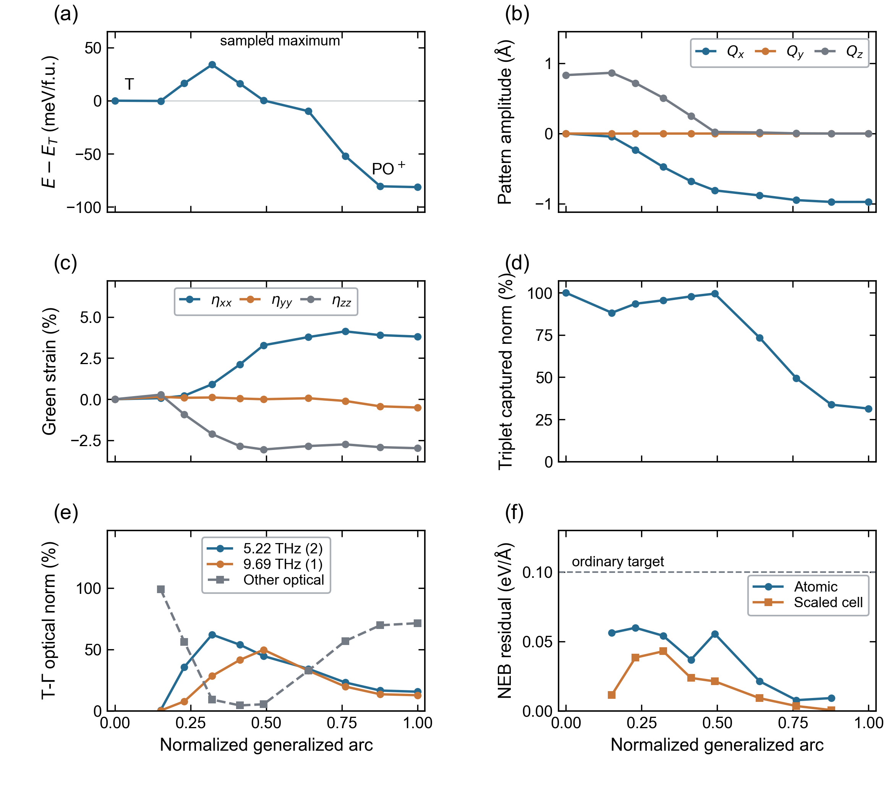
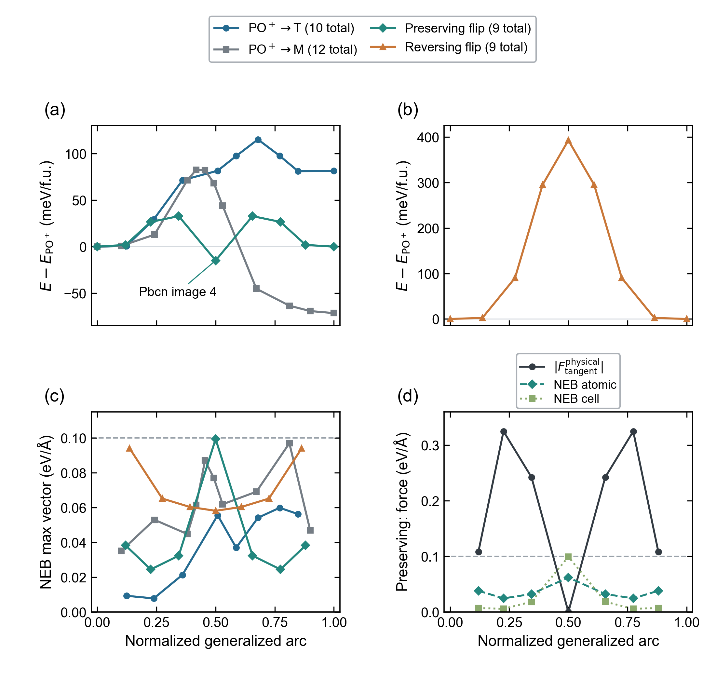
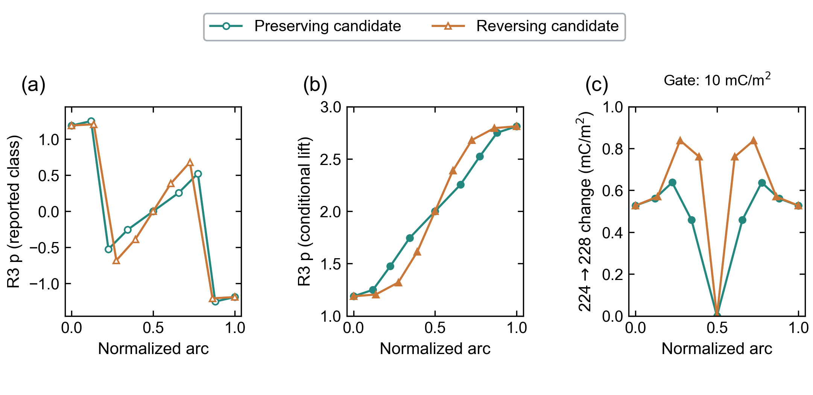
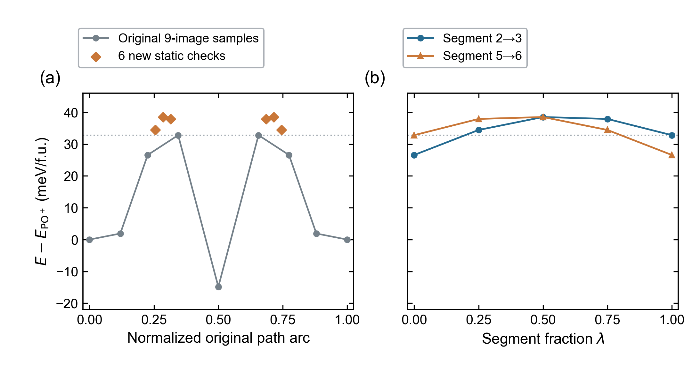
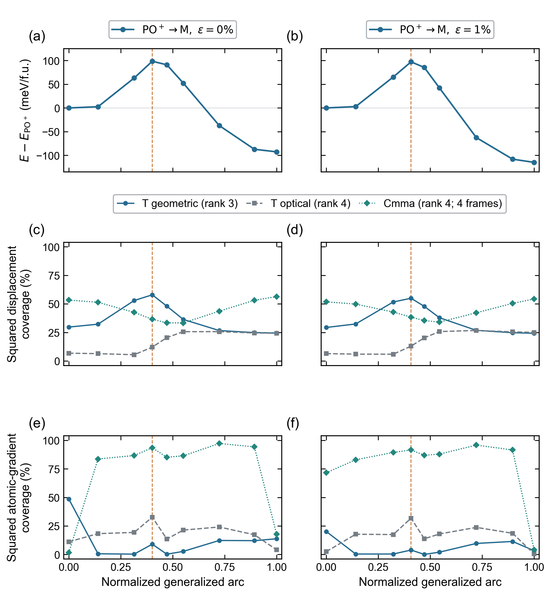

# Competing switching and phase-escape channels in hafnia: a mode-strain pathway analysis

## Abstract

Mechanical constraints can alter polarization-reversal paths while also
changing the routes by which a polar crystal leaves its original phase.
We examine this competition in twelve-atom HfO2 using first-principles
variable-cell nudged elastic band calculations under a common partially
clamped boundary. Four ordered candidates connect the same polar initial
well to opposite-polar variants or tetragonal and monoclinic structures.
At +1% substrate strain, the higher switching candidate decreases by
44.0 meV/HfO2, whereas the lower switching candidate increases by
28.6 meV/HfO2, exceeding the 12.3 meV/HfO2 increase of the lowest examined
escape peak. Signed oxygen-shuffle coordinates distinguish preservation,
reversal and reorientation of the reference distortion, accompanied by
different open-axis responses. Matched local controls show that most of
the preserving neighborhood's relaxation energy is recovered through
atomic rearrangement at fixed seed cells. A prospectively frozen +0.5%
test yields sampled peaks of 98.5 and 90.4 meV/HfO2 for preserving
switching and tetragonal escape. Their difference varies nonmonotonically
over the three strains; interpolation misses the preserving peak by
12.6 meV/HfO2 while describing tetragonal escape closely. These results
show why mechanical control must be assessed through competing atomic-cell
routes rather than a single decreasing switching profile. The conclusions
concern the declared ordinary-converged sampled paths; the independent
test supports no additional predictive advantage of the local reduced models.

## 1. Introduction

Ferroelectric hafnia combines polar and nonpolar structures that can be
connected by relatively small atomic shuffles and lattice deformation.
A useful polar state must support reversal while resisting transformation
into another structural phase. These requirements involve different
trajectories on the energy landscape: reducing a switching barrier can
also change the barriers for leaving the polar well. The relevant
mechanical-control question is therefore how an imposed constraint changes
the competition between these routes from one common initial state.
This distinction matters even before effects such as domain-wall motion,
defects and temperature are introduced.

Prior work establishes both the mechanical sensitivity of hafnia pathways
and their connection to lattice distortions. Liu and Hanrahan showed that
orientation, epitaxial strain and clamping affect phase stability and
variable-cell transformation barriers. Behara and Van der Ven described
structural variants and their pathways in strain coordinates and connected
intermediate shuffle patterns to mechanically constrained domain boundaries.
([Liu and Hanrahan, 2019](https://doi.org/10.1103/PhysRevMaterials.3.054404);
[Behara and Van der Ven, 2022](https://doi.org/10.1103/PhysRevMaterials.6.054403))
Mode-based studies identify coupled polar and nonpolar distortions:
Delodovici, Barone and Picozzi analyzed trilinear coupling, while Qi, Singh
and Rabe showed that reversal can involve distinct accompanying antipolar
changes and switching paths.
([Delodovici et al., 2021](https://doi.org/10.1103/PhysRevMaterials.5.064405);
[Qi et al., 2025](https://doi.org/10.1103/PhysRevB.111.134106))
Thus neither the existence of coupled modes nor the multiplicity of
switching routes is the new claim of this work.

Reference choice and boundary conditions further shape the physical
interpretation. A Cmma reference organizes competing phases through
unstable phonon bands, while strain-dependent mode models describe changes
in the tetragonal-to-polar landscape.
([Qi and Rabe, 2025](https://doi.org/10.1103/9759-kp38);
[Lee, Lee and Yu, 2026](https://doi.org/10.1038/s41535-025-00841-9))
Constrained-mode landscapes and subsequent NEB checks have also been used
to study an antipolar switching intermediate.
([Zhou et al., 2022](https://doi.org/10.1126/sciadv.add5953))
The energetic role of Pbcn depends on the functional and mechanical
ensemble; fixing a PO-referenced lattice gives a different comparison
from allowing selected cell directions to relax.
([Fan et al., 2025](https://doi.org/10.1038/s41524-025-01647-w))
Likewise, a phase-pair name alone does not specify the ordered atomic
mapping, as illustrated by distinct M-to-PO candidates in the public
Ma--Liu study.
([Ma and Liu, 2023, v3 supplement](https://arxiv.org/pdf/2204.09374v3#page=24))
Phonon-pair condensation can also explain low-energy domain walls, although
an interface energy and a homogeneous transformation profile describe
different physical processes.
([Lee et al., 2026](https://doi.org/10.1103/63lf-k7zs))

These results motivate a comparison that keeps three questions together.
Which examined route has the lower peak from the same polar well? Which
atomic rearrangements and permitted strains distinguish the routes?
How far does their observed response transfer to an independently
evaluated mechanical condition? Endpoint energy shifts answer only part
of the first question, and a compact displacement projection does not by
itself answer the third. A useful analysis must connect the full path
energies to actual structures and then test the explanatory or predictive
role of selected coordinates.

Here we compare two ordered reversal candidates and escape to tetragonal
and monoclinic HfO2 under one T-referenced substrate constraint. We use the
polar orthorhombic Pca21 structure, denoted PO, as the common initial well;
T and M denote the tetragonal P42/nmc and monoclinic P21/c structures.
The reversal candidates preserve or reverse a signed reference oxygen
shuffle while reversing the polar structural displacement. VARNEB provides
the common atomic-cell path representation and energy/force/stress
interface. We combine their energy profiles with signed shuffle amplitudes,
open-cell deformation and matched frozen, atomic-only and joint relaxation
controls. Finally, forecasts fixed before the target-interior calculations
are compared with two +0.5% paths. The contribution is a common-reference
analysis linking channel competition to atomic and lattice accommodation,
testing a local relaxation explanation and checking response transfer at
an independently evaluated strain. Keeping the candidate identities,
permitted deformations and energy reference together makes the physical
comparison explicit.

## 2. Theory and computational approach

### 2.1. Joint pathways and a common energy reference

Ordinary NEB relaxes the physical force perpendicular to the path while
springs control image spacing.
([Henkelman and Jonsson, 2000](https://doi.org/10.1063/1.1323224)) Atomic-cell extensions incorporate lattice
degrees of freedom with an explicit relative metric.
([Sheppard et al., 2012](https://doi.org/10.1063/1.3684549);
[Qian et al., 2013](https://doi.org/10.1016/j.cpc.2013.04.004))
VARNEB applies these established path ideas through energy, force and stress
results obtained via ASE-compatible calculators.
([Larsen et al., 2017](https://doi.org/10.1088/1361-648X/aa680e))
The backend, optimizer and
mechanical active space are independent choices. Ordered atoms, reference
cells and continuous periodic lifts are preserved during optimization and
analysis; an image-wise remapping is not a physical pathway improvement.

For candidate channel $\alpha$ at condition $c$, define its bottleneck barrier
from the same initial well $I$ as

$$
B_\alpha(c)=E^\dagger_\alpha(c)-E_I(c).
$$

Here a stationary bottleneck and a discrete sampled maximum are distinguished;
the latter is denoted by a hat in the pilot interpretation. With a common $I$,
the initial-well energy cancels from $B_\alpha-B_\beta$. A change in relative
channel selectivity thus cannot be explained by shifting that common well
alone. In the declared candidate set, we use

$$
B_s=\min_{\alpha\in\mathcal S}B_\alpha,\qquad
B_d=\min_{\alpha\in\mathcal D}B_\alpha,\qquad S=B_d-B_s.
$$

An increased $S$ is relative selectivity, not improved absolute resistance to
escape. The stronger prospective test requires a resolved reduction of $B_s$
and a lower uncertainty bound on $\Delta B_d$ no smaller than zero. An unresolved
decay response is inconclusive, not evidence of noninferiority. This primary
allowable-loss margin is fixed before boundary-response labels. Both T and M escape candidates
are retained. These are candidate-set statements, not an exhaustive network
or a calculation of device lifetime. At finite prescribed pressure the
objective would be $E+PV$; all hafnia results here instead use $P=0$ and $E$.

### 2.2. Mechanical boundary, ordered coordinates and mode interpretation

The partially clamped ensemble fixes two T-referenced in-plane cell vectors
and releases the third vector, including its two permitted tilt components.
Every endpoint and image shares that allowed space. In the original T
chart, x and z follow the prescribed substrate strain, while y remains
open. Zero substrate strain denotes the unscaled reference plane and
differs from a fully stress-free crystal. At each condition the initial
and final wells are separately relaxed under the same boundary.

We preserve atom order and a continuous periodic lift over each chain.
For the structural interpretation in Figure 3, fractional displacements
are expressed in one original-T Cartesian metric after removal of rigid
translation. Three orthonormal geometric oxygen-shuffle patterns, obtained
from the tetragonal distortion and its rotated variants, define signed
amplitudes $Q_x$, $Q_y$ and $Q_z$ in Angstrom. The patterns describe the path
geometry and do not assign phonon irreducible representations or energies
to individual modes. A polar-displacement descriptor is the mean O minus
mean Hf displacement along the original polar z direction; electronic
polarization requires a separate calculation.

Cell response is reported separately through the deformation gradient F.
The plotted open-axis stretch is $100(F_{yy}-1)$, distinct from the
Green-strain component and from an elastic energy. Atomic projections,
cell stretch and their joint energy response answer different questions.
The alternative mass-weighted T optical and Cmma reference comparisons
remain in Appendices D and F, with every original rank and registration
retained. Coordinate and boundary identities are not selected from the
independent labels.

For the free-cell/clamped comparison, each band has its own relaxed
endpoints and initial energy. A constraint orders ideal minimax barriers
only when those endpoints and the thermodynamic potential are common.
The present relaxed-endpoint comparison does not meet that premise.
Appendix B gives a simple counterexample; Appendix G retains the detailed
boundary and response derivations.

### 2.3. Electronic calculations and matched local relaxation

The production model is periodic Hf4O8, twelve atoms and four formula units,
at zero temperature, external pressure and electric field. Calculations use
ABACUS/PBE, the original Hf/O pseudopotentials, full 10-au DZP orbitals
generated at 100 Ry, ecutwfc=100 Ry and the original Gamma-centred 2x2x2 mesh.
The same input, pseudopotential and orbital bytes apply to every comparison.
The unchanged electronic settings are scf_thr=1e-8, scf_nmax=150 and
mixing_beta=0.3.
([Li et al., 2016](https://doi.org/10.1016/j.commatsci.2015.07.004);
[Chen et al., 2010](https://doi.org/10.1088/0953-8984/22/44/445501);
[Perdew et al., 1996](https://doi.org/10.1103/PhysRevLett.77.3865))
Byte-exact [INPUT](../../benchmarks/hfo2_channels/20261008/manuscript_local_reduction_E162_20261015/INPUT)
and [KPT](../../benchmarks/hfo2_channels/20261008/manuscript_local_reduction_E162_20261015/KPT)
files accompany the data. A calculation at a changed geometry always obtains
new energy, forces and stress; only exact endpoint caches are reused.

The clamped channel comparisons use nine total images, including seven
moving interior images, and the unchanged ordinary NEB residual target
0.10 eV/Angstrom. No climbing image is used. The ten-image historical
T-to-PO formation band, finite sampling supplements and free-cell
candidates are retained separately in Appendix C. These are distinct
calculations rather than alternative resolutions silently pooled into
one optimized path. A residual pass determines ordinary convergence
for the declared polygon and does not bound its continuous-barrier error.

To distinguish local atomic accommodation from additional cell response,
we compare three treatments at fixed retained joint coordinates
$q=(Q_1,Q_2)$:
a frozen configuration F, atomic-only release A at that configuration's
cell, and joint atomic/open-cell release J. Each of the preserving and
T sampled-peak neighborhoods uses its origin and four axial q pairs.
The local chart has 33 translation-free atomic and three open-cell length
coordinates with scale $L=5.12968067458423$ Angstrom; q is not the geometric
$Q_x$/$Q_z$ projection. Retained coordinates are held fixed. The atomic-only
treatment releases 31 atomic directions; joint release also allows the
permitted cell response.

The pointwise differences $E_A-E_F$ and $E_J-E_A$ measure the observed
treatment contrasts. The latter includes atomic readjustment as well as
cell motion, so it is not a unique strain-energy term. The released-gradient
target is 0.03 eV/Angstrom, distinct from the NEB threshold. Finite-step
curvature probes, branch trials, model definitions, geometry guards and
actual costs are retained in Appendices D--G. These diagnostics do not
replace the measured path peaks or imply stable conditional minima.

### 2.4. Prospective strain test and prediction comparison

Eight training bands compare all four candidates at substrate strain
0 and +1%. Before generating target structures, the lower sampled
switching and escape representatives at zero strain were selected:
preserving reversal and PO-to-T. Their ordering at a new condition was
not used to change that selection. Three +0.5% endpoints were then
optimized under the imposed plane with atomic force at most
0.03 eV/Angstrom and open traction below 2 kbar. Endpoint features were
shared equally by the forecast arms that require them. The complete
numerical and unavailable prediction panel was frozen before evaluating
either target path's interiors.

B0 predicts the arithmetic midpoint of each zero/+1% sampled peak.
With zero-strain anchor $\widehat B(0)$ and measured initial/final well
shifts $\Delta E_I,\Delta E_F$ per formula unit, the two endpoint controls are

$$
\widehat B_{\mathrm{B1,fixed}}=\widehat B(0)-\Delta E_I,\qquad
\widehat B_{\mathrm{B1,follow}}=\widehat B(0)+\Delta E_F-\Delta E_I.
$$

All local response models and reference variants remain in the panel.
A model that had not supplied a valid transfer to the physical strain
control records an unavailable prediction rather than an inferred value.
Errors retain their signs; channel errors and the T-minus-preserving
error use the same initial-well convention.

Each target band starts from its corresponding zero-strain polygon,
with the plane affinely changed and the new endpoint corrections
distributed along image index. The fixed recipe uses FIRE,
$k=0.2$ eV/Angstrom squared, maxstep 0.02 Angstrom, maximum cell step
0.02, minimum pair distance 1.6 Angstrom and maximum deformation 0.25.
It permits at most 80 updates, four candidate-step retries and 24 hours
per path. The nine-image target and 0.10 eV/Angstrom criterion are unchanged.
Both paths use native 32-rank mpirun allocations with one thread per rank.

The scored observable is the endpoint-inclusive sampled peak relative
to the common PO+ well. We report its change from zero strain, the
selected-pair difference, every frozen error or abstention, and actual
SCF/allocation cost. The [complete preregistration and data](../../benchmarks/hfo2_channels/20261008/physical_holdout_E268_20261018/README.md)
record the chronology. This fixed-protocol check tests response transfer;
it does not search for new channels or resolve continuous-path curvature.

## 3. Results: competing responses under one mechanical intervention

### 3.1. Strain changes channel competition, not just one switching peak

All eight registered clamped training bands passed the unchanged ordinary
0.10 eV/Angstrom residual criterion. Each substrate condition used one
identical ordered PO+ starting cache for all four candidates; energies at
different conditions were referred to their own relaxed PO+ wells. Figure 1 and Table 1
therefore compare the same four registered correspondences, not selected
snapshots with different initial-state offsets. The full forward/reverse
values and final-well differences are retained in Appendix D, Table A4.

Figure 1. Channel-dependent response under the same partially clamped
boundary. (a) Sampled forward peaks at zero and +1% substrate strain, each
relative to its condition's common PO+ well. (b) Observed changes compared
with the final-well-only B1 response, which assumes that the absolute peak
follows the final-well shift. The two switching endpoints have the same
well-energy response but their sampled peaks change in opposite directions.
All four registered candidates are shown. Bars are deterministic path
observations, not replicate means; no barrier-error interval is inferred
from the ordinary NEB residual.

Table 1. Sampled forward peaks under the matched boundary, in meV/HfO2.
The last column is the +1% value minus the zero-strain value, not a derivative.

| Candidate | Zero strain | +1% strain | Change |
|---|---:|---:|---:|
| PO-to-M | 98.458122 | 97.227719 | -1.230403 |
| PO-to-T | 84.416624 | 96.763650 | 12.347027 |
| Preserving flip | 96.828183 | 125.424431 | 28.596248 |
| Reversing flip | 338.968965 | 294.944634 | -44.024331 |

The preserving and reversing switching peaks changed by opposite signs.
The decrease of the reversing peak by 44.024331 meV/HfO2 did not make it the
lower examined switching candidate: it remained above the preserving peak
at both training conditions. The lower sampled switching peak increased by
28.596248, whereas the lower sampled escape peak increased by 12.347027.
The sampled selectivity proxy, escape minus switching peak, consequently
changed from -12.411559 to -28.660781 meV/HfO2. Its decrease of 16.249222 is
not the favorable signature of simultaneously easing switching and
retaining resistance to escape.

This is an observed candidate-set contrast, not an error-certified rejection
of the original favorable-response hypothesis or a global pathway ordering. The +1% T/M escape peaks differ by only
0.464068 meV/HfO2, and ordinary residuals do not bound sampled-barrier error
or certify stationary bottlenecks. Both escape candidates and both ordered
switching candidates remain in the analysis; the decreasing but high
reversing candidate is not used alone to claim improved switching.

The response difference is not an initial-energy-offset effect. The common
PO+ well rises by 6.806502 meV/HfO2. Before subtracting it, the preserving
sampled peak rises by 35.402751, whereas the reversing peak falls by
37.217829 meV/HfO2. Thus the opposing switching responses persist on the
absolute energy scale. The configurations in the path interior, not merely
the shared starting or final wells, must enter an explanation.

Final-well response alone also failed to reproduce these sampled changes.
Table 2 gives the preregistered final-following B1 null increments. The
alternative fixed-absolute-bottleneck null gives -6.806502 meV/HfO2 for
every channel because their initial well is common. For PO-to-T the
final-following increment is +1.785908, compared with the observed +12.347027;
for PO-to-M it is -22.206479, compared with -1.230403. These are seen training
comparisons, not independent predictive wins or error-resolved null rejection.

Table 2. Seen final-well shifts and final-following B1 barrier-response
increments, in meV/HfO2. Neither column is a measured bottleneck slope.

| Final endpoint representation | Observed well-energy shift | B1 final-following barrier increment |
|---|---:|---:|
| T descendant | +8.592411 | +1.785908 |
| M | -15.399977 | -22.206479 |
| PO-, T pattern preserving | +6.841761 | +0.035259 |
| PO-, T pattern reversing | +6.841761 | +0.035259 |

The [complete native training replay](../../benchmarks/hfo2_channels/20261008/clamped_plus1_reversing_terminal_E148_20261014/README.md)
retains 72 frame records and 66 distinct raw-log/geometry identities,
including the repeated common initial caches. They are not independent
statistical replicates. The independent +0.5% test is reported separately
in Section 3.4; these training values alone do not establish independent predictive accuracy.

### 3.2. Clamping changes the sampled energetic role without changing the group label

The preserving paths offer a direct check of the earlier low-energy-centre
caveat (Appendix C.2). Reanalysis of the original free-cell step-69 band and
the zero-strain clamped terminal band identifies both central samples as
Pbcn at each fixed 0.001/0.01/0.05 Angstrom tolerance and 1-degree angular
tolerance. No structure is standardized, remapped or relaxed in this analysis.
Nevertheless, their sampled energetic roles differ (Figure 2). The free-cell
centre is -14.838201 meV/HfO2 relative to its own PO+ well and lies below
both adjacent samples. The clamped centre is +96.828183 meV/HfO2 relative
to its different, boundary-relaxed PO+ well and lies above both adjacent
samples. The low central region is therefore not present on this clamped
band, even though the same group label remains. This does not establish
that every possible clamped Pbcn branch has disappeared or that either
centre is a stationary minimum or index-one saddle.

Figure 2. Preserving-pattern candidates with free cell (blue solid) and
zero-strain clamp (orange dashed), using the unchanged electronic contract.
(a) Native energies relative to each band's own PO+ initial well, not one
common initial configuration. (b) Stretch $F_{xx}$ in the common original T
chart. Hollow squares identify the two Pbcn central samples; they are not
certified TSs or stable intermediates. Nine existing samples per path are
shown with straight connectors, with no smooth-MEP fit, statistical error
band or independent replicate interpretation. The original free-cell
nine-point sampled peak is 32.806023 meV/HfO2; the already measured sampling
supplement raises its union maximum to 38.508448, which is not plotted as
an additional optimized chain. Source CSV, the full tolerance sweeps and
native-audit provenance are provided in the dated analysis case.

The geometries provide an associated boundary diagnostic. In the original
T chart, the free-cell centre has $F_{xx}=1.122022$; clamping fixes $F_{xx}$ and $F_{zz}$
to unity throughout the zero-strain band while allowing the original y
direction and two corresponding tilts to respond. The atomic arrangement
and allowed-cell response are both optimized along each band. Thus this
comparison is neither a frozen-geometry energy difference nor an isolated
strain derivative at one state. The six electronic input hashes are the
same, but the mechanical boundaries, initial wells and original generalized
metrics differ. Each band keeps its native normalized arc; equal abscissae
are not a structural matching operation.

Clamping therefore changes more than the magnitude of a plotted energy:
the same symmetry-labelled sample can lie in a low central region or at the
sampled peak, depending on which deformation is permitted. The large
free-cell x expansion shows why a phase label alone cannot specify its
energetic role. The next comparison follows the actual atomic arrangements
and the remaining open-cell response under one fixed boundary.

### 3.3. Distinct oxygen-shuffle routes couple to different lattice responses

The two switching paths reverse the polar displacement but do not perform
the same oxygen rearrangement (Figure 3). To display that difference, we
project the ordered, continuously lifted fractional displacements into
one fixed original-T Cartesian metric. Three unit-normalized geometric
oxygen-shuffle patterns, constructed from the tetragonal reference and
its rotated variants, define signed amplitudes $Q_x,Q_y,Q_z$ in Angstrom.
A single initial periodic gauge is held over each whole chain; atoms are
not rematched image by image. These amplitudes are geometric descriptors,
not phonon occupations, assigned irreducible representations or the local
joint coordinates $Q_1,Q_2$ used below. The companion polar descriptor is
the mean oxygen displacement minus the mean hafnium displacement along
the original polar z direction; it is not an electronic polarization.

Both zero-strain flips take this polar displacement from approximately
+0.275 to -0.275 Angstrom. In the preserving route, however, the oxygen
shuffle $Q_x$ remains negative: it is -0.930 at the initial well, -0.799
at the sampled peak and -0.925 Angstrom at the final well. The reversing
route takes the same initial negative shuffle through nearly zero at its
sampled peak to +0.925 Angstrom. At +1% strain the preserving peak retains
an even larger negative amplitude, -1.046 Angstrom, while the reversing
peak again has nearly zero $Q_x$. The opposite barrier responses in
Section 3.1 thus concern different atomic routes, even though both reverse
the polar displacement and reach equivalent final-phase energies.
Polar reversal alone does not label the path.

Figure 3. Energy, oxygen-shuffle coordinates and open-axis stretch on the
preserving flip (left), reversing flip (middle) and PO-to-T escape (right).
Blue circles and orange squares denote zero and +1% substrate strain;
green diamonds add the independent +0.5% preserving and T paths. The
reversing path was not evaluated at the midpoint. (a--c) Native energies relative to the matched initial well; the reversing
column has a larger energy range. (d--f) Signed geometric $Q_x$ (solid)
and $Q_z$ (dashed), in the same fixed reference metric and on common scales.
(g--i) $100(F_{yy}-1)$ in the original T chart, with x and z prescribed by
the substrate. This stretch is not the Green-strain component or a strain
energy. Each chain has its own normalized generalized arc; equal abscissae
do not match structures between chains. Points are the nine actual images,
including cached endpoints; straight connectors are not a fitted continuous
MEP. All ten chains, including PO-to-M at the two training strains, and the
omitted-coordinate norms are exported with the figure source.

The T escape provides the complementary structural change. Instead of
ending at the opposite polar well, it removes the initial negative $Q_x$
and builds a positive $Q_z$, reaching 0.832 and 0.886 Angstrom at the two
T endpoints. The polar displacement tends to zero. Along the sampled
peak region the two patterns coexist: at zero strain the amplitudes are
$Q_x=-0.723$ and $Q_z=0.137$ Angstrom. The escape and switching candidates
therefore share part of their initial distortion but differ in how it is
removed or transferred into the final arrangement. A small displayed
amplitude must not be mistaken for a high-symmetry crystal: at the reversing
peaks the atomic displacement outside this triplet still has norm 1.392
and 1.895 Angstrom. The full-space and alternative-reference comparisons
are retained in Appendices D.3 and F.1.

The allowed lattice response distinguishes these routes further. In the
original T chart, x and z follow the substrate while y and its permitted
tilts remain free. At the preserving sampled peak, the y stretch changes
from -0.058% to +0.304% on increasing substrate strain. At the reversing
peak it decreases from +1.741% to +1.417%; at the T escape peak it becomes
more contractive, from -0.392% to -0.799%. These measurements connect the
energy comparison to different coupled atomic-cell trajectories. They do
not partition the energy into separate shuffle and elastic contributions:
the coordinates relax together, and correlation of a stretch with a peak
shift is not an isolated causal test.

The matched local relaxation calculations provide such a test at a more
limited level (Figure 4). At each of five fixed pairs of local retained
coordinates, we compare a frozen configuration, atomic-only release at
its seed cell, and joint atomic/open-cell release. Across the five
registered coordinates near the preserving peak, atomic relaxation alone
lowers the energy by 11.016--12.087 meV/HfO2; the joint candidates are a
further 0.201--0.284 meV/HfO2 lower. In the T neighborhood the corresponding
ranges are 0.068--0.166 and 0.086--0.302 meV/HfO2. The large preserving
lowering is therefore already present when the cell is held fixed at
each seed, and cannot be attributed solely to release of the open lattice
direction. Additional joint release includes atomic readjustment, so its
energy difference is not a unique elastic contribution.

Figure 4. Measured local energy lowering at the five prescribed retained
coordinate pairs around (a) the preserving and (b) the T sampled peaks.
Blue bars show $E_{\mathrm{frozen}}-E_{\mathrm{atomic}}$; orange increments
show $E_{\mathrm{atomic}}-E_{\mathrm{joint}}$. The two panels deliberately
use different vertical ranges. All ten physical points are included once;
the two curvature probe steps are not duplicate energy observations.
$Q_1,Q_2$ are the fixed joint-length coordinates of Section 2.3, not the
geometric $Q_x,Q_z$ of Figure 3. Each atomic-only treatment fixes its own
frozen-Q seed cell. The total height is a local candidate-energy lowering,
not a correction to the complete path barrier.

Together, these observations support a physical interpretation in terms of
route-specific accommodation: the same substrate constraint acts on different
oxygen rearrangements and on their different available lattice responses.
The relaxation contrast further identifies internal atomic accommodation
as an important contributor in the selected preserving neighborhood.
It does not identify one mode as the sole cause of the barrier change.
In particular, the preserving origin still fails the original necessary
sign condition after the two-coordinate release. Its shallow omitted
oxygen-dominated direction and the bounded attempts to follow it are
reported in Appendices E.7 and F.1. We therefore retain the measured
relaxation effect without calling this neighborhood a stable conditional
surface or retroactively lowering the path barrier.

### 3.4. The independent strain test resolves different sampled responses

Both preregistered +0.5% bands met the same ordinary NEB criterion:
the preserving flip reached 0.079773 eV/Angstrom and PO-to-T reached
0.080825 eV/Angstrom. Their nine-image sampled peaks were 98.530877
and 90.418178 meV/HfO2, respectively (Figure 5). Relative to zero strain,
the preserving peak increased by 1.702694, whereas the T escape peak
increased by 6.001554 meV/HfO2. The common starting well, electronic inputs,
ordered path definitions and stopping criterion were kept as registered.

The selected-pair contrast, T minus preserving, was -8.112699 meV/HfO2
at +0.5%, compared with -12.411559 at zero and -28.660781 at +1%.
Thus the midpoint contrast improved by 4.298861 meV/HfO2 relative to zero,
before worsening at the larger imposed strain. It remained negative:
escape still had the lower sampled peak in this tested pair. This changes
the interpretation from a uniformly unfavorable strain trend to a
nonmonotonic sampled competition. Only the two preselected channels were
computed at +0.5%; their comparison does not establish the complete
four-channel ordering at that condition.

Figure 5. The independently evaluated +0.5% mechanical condition.
(a,b) Actual nine-image preserving and PO-to-T profiles alongside their
zero/+1% training bands; blue, green and orange encode strain.
(c) Sampled peaks versus strain, with blue circles for preserving and
orange squares for T escape. Hollow diamonds are the B0 midpoint forecasts
frozen before target-interior evaluation. (d) Signed errors of all three
numerical forecast arms. Channel colors in (c,d) differ from the strain
colors in (a,b), as specified by the separate legends. Straight connectors
are visual guides through measured samples; no smooth-MEP or strain fit is
introduced. Both bands use the same target PO+ cache and the same electronic
parameters. No uncertainty interval is inferred from the force criterion.

The frozen B0 interpolation was accurate for T escape at this resolution
but overpredicted the preserving peak by 12.595430 meV/HfO2 (Table 3).
Its predicted pair contrast, -20.536170, missed the measured value by
-12.423471 meV/HfO2. Conversely, both endpoint-only B1 forecasts were closer
for preserving than B0 but less accurate for T escape. B1-follow had the
smallest maximum error across the two paths, 5.004639 meV/HfO2. A single
linear response inferred from the two outer strains therefore did not
describe both registered channels equally well.

Table 3. Frozen physical-strain forecast errors, prediction minus DFT,
in meV/HfO2. Pair error is the error in T minus preserving. All three
models cover both targets; there is no post-label calibration.

| Model | Preserving error | T error | Max. absolute error | Mean absolute error | Pair error |
|---|---:|---:|---:|---:|---:|
| B0 midpoint | 12.595430 | 0.171959 | 12.595430 | 6.383694 | -12.423471 |
| B1 fixed absolute peak | -2.933378 | -7.232239 | 7.232239 | 5.082809 | -4.298861 |
| B1 final-well following | -1.667843 | -5.004639 | 5.004639 | 3.336241 | -3.336796 |

The structural check preserves the distinction between the two routes
(Figure 3). At the +0.5% preserving peak, $Q_x=-0.798917$ Angstrom and
$Q_z$ remains nearly zero, close to the zero-strain pattern and different
from the larger negative $Q_x$ at +1%. The T peak instead retains mixed
$Q_x=-0.725241$ and $Q_z=0.150244$ Angstrom, intermediate in $Q_z$ between
the two training conditions. Their open-y stretches are -0.416145%
and -0.605986%, respectively. The midpoint data therefore retain the
route identities while exposing different sampled energy and lattice
responses; no new phase or bifurcation is assigned from these descriptors.

This test used the registered zero-strain polygons as warm starts after
affinely imposing the target plane and distributing the relaxed endpoint
corrections. The preserving seed already passed the ordinary criterion
after its first seven interior SCFs, with no optimizer update; T required
two updates and 21 interior SCFs. These are completed fixed-protocol tests,
rather than independent searches over starting paths. Their finite image
resolution, stopping tolerance and history do not separate genuine
continuous-path curvature from numerical path-relaxation effects.
Accordingly, the measured deviation from B0 is reported for the declared
sampled observable, without claiming a transition-state error bound.

All 138 frozen forecast records remain: six numerical predictions and
132 unavailable physical-transfer records across the two cases.
The local reduced models had not supplied a valid transfer to this
physical control, so this test establishes no predictive advantage for
a branch-adapted mode model. The bounded physical test is complete; its
outcome does not initiate model reselection. The 28 path SCFs and eleven
endpoint SCFs consumed 47.289888 native-call proxy core-hours and
48.808889 allocation core-hours together. Earlier training, curvature
and local-model preparation remain additional.

An independent prediction advantage has not yet been established. The
prospective T local test supplied eight independent candidate energies,
with coordinates and model predictions frozen beforehand. All eight
reached the prescribed released-gradient target in eighteen native SCFs.
The tensor-quadratic interpolant had a maximum origin-aligned error of
0.089077 meV/HfO2, versus 0.129769 and 0.131911 for the two original
curvature models. The original models had smaller unaligned maxima,
however; the ranking depended on the declared energy-zero convention.
This supports local candidate-energy description on that tested domain,
not a unique benefit of an adaptive reference.

The separately revised preserving test also completed all eight candidates
with both gradient tests in 24 native SCFs. On the seven targets shared
by the four new family/step arms, adding the retained-direction nonlinear
terms slightly reduced RMSE but increased maximum error at both steps.
For example, at the first step the harmonic/nonlinear maxima were
0.033195/0.035625 meV/HfO2 and their RMSEs were 0.027153/0.024916.
These small local errors do not establish a physically resolved model
advantage or remove the original two-coordinate refusal. Coverage,
all older controls, unsuccessful training starts and actual preparation
costs remain in Appendices E.8--E.9 and F.2. No independent labels were
used to refit these predictions.

## 4. Discussion: mechanical control acts on the route as well as the wells

The central finding is a mismatch between lowering one switching path and
improving the competition available to the polar crystal. Under the
examined +1% substrate intervention, the high reversing candidate becomes
lower while the already lower preserving candidate becomes higher.
The easiest sampled escape candidate rises less than the preserving
candidate, so the escape-minus-switching contrast becomes more negative.
Within this declared candidate set, +1% strain therefore does not
produce the favorable switching-versus-escape response sought here.
Selecting only the decreasing reversing barrier would give the wrong
account of this competition.

The independent midpoint refines this conclusion. At +0.5%, the selected
escape-minus-switching contrast improves relative to zero strain but stays
negative; at +1% it is more negative. The registered sampled competition is
therefore nonmonotonic over these three conditions. The preserving peak's
midpoint deviation from B0 contrasts with the nearly interpolating T peak,
while the signed mode patterns retain their route identities. This favors
examining route-dependent atomic and lattice accommodation over an
interpretation based only on endpoint well shifts. The warm-started ordinary
bands do not identify a physical bifurcation or isolate the origin of this
finite-resolution nonlinearity.

The mode and strain results explain why a single polar coordinate or an
endpoint phase label is insufficient. The two flips reverse essentially
the same polar displacement but preserve or reverse a signed oxygen
shuffle, respectively. Escape to T instead exchanges the initial pattern
for its differently oriented tetragonal counterpart. These distinct
rearrangements have different open-axis responses under the same imposed
substrate change. The equal final-well responses of the two flips cannot
account for their opposite peak shifts. Their path interiors must be
resolved to interpret the mechanical response.

Mechanical boundary conditions also determine which accommodation is
available. The free-cell preserving path develops a large x expansion
near its low central region; that expansion is excluded by the clamped
ensemble, where the same Pbcn-labelled central sample has a high energy
relative to its own initial well. This is a boundary-dependent role of a
configuration family, not a universal energetic meaning of a space-group
label. A comparison of relaxed endpoints must therefore retain the
mechanical ensemble as part of the definition of the pathway.

The local treatment comparison adds evidence beyond geometric correlation.
The large energy lowering near the preserving peak already occurs during
atomic release at each fixed seed cell, whereas the T neighborhood has
a much smaller atomic lowering. Thus lattice freedom is not the sole
source of relaxation in the preserving neighborhood. This result supports
a coupled atomic-cell interpretation without assigning a unique energy
fraction to one mode. It also explains why a visually compact two-coordinate
plot can omit energetically important accommodation. The observed effect
remains local: it is not a replacement for a newly optimized whole path.

The model tests place an important limit on the methodological claim.
A complete change of coordinates leaves the same quadratic response
unchanged, and the independent candidate-energy tests do not show a
metric-independent accuracy gain for the added nonlinear family. These
outcomes do not negate the measured channel competition or structural
contrast. They instead separate the material result from a stronger,
currently unsupported claim that one particular reduced model predicts
it better. The contribution is the connected comparison of competing routes, their
mechanical responses, a controlled local relaxation test and a prospectively
frozen physical-strain test. A new predictive-method claim would require
additional independent evidence beyond the completed comparison.

The quantitative scope is periodic twelve-atom hafnia at zero field and
temperature under the fixed ABACUS/PBE contract. The four ordered candidates
are not an exhaustive search, ordinary-converged sampled peaks are not
certified stationary transition states, and the strained T/M separation
of 0.464068 meV/HfO2 is not a resolved physical ordering. The study does
not infer device switching rates, retention times, domain-wall nucleation
or finite-temperature free energies. The registered +0.5% test is now
complete, with both successful path outcomes and all model abstentions
retained. The resulting evidence supports a material pathway comparison
and explicit limits on response transfer, rather than a validated new
predictive reduction method.

## 5. Conclusions

Mechanical control of hafnia must be assessed through the competition
between complete structural routes from the same polar well. Within the
examined clamped candidate set, +1% strain lowers the high reversing
switching peak while raising the already lower preserving peak more than
the lowest escape peak. Selecting the decreasing switching profile alone
would therefore misrepresent the available competition. The independent
+0.5% test adds a different response: the selected escape-minus-switching
contrast improves relative to zero strain but stays negative, giving a
nonmonotonic sampled trend over the three imposed conditions.

The structural comparison identifies the atomic and lattice accommodation
that distinguishes the routes.
Reversal of the polar displacement can accompany preservation or reversal
of a signed oxygen shuffle; escape to T transfers the initial distortion
into a differently oriented pattern. Each route uses a different allowed
lattice response. Equal final-well shifts cannot explain the opposite
switching-peak changes, so the path interior must enter the interpretation.
Clamping also changes the sampled energetic role of
a Pbcn-labelled central configuration while excluding the large expansion
seen on the free-cell path. Matched local controls show that internal
atomic relaxation already recovers most of the preserving neighborhood's
energy lowering at fixed seed cells. These observations support coupled
atomic and lattice accommodation as the physical basis for interpreting
the route differences, with no unique mode-by-mode energy partition.

The independent comparison further shows that good interpolation for
T escape does not ensure a comparable description of preserving reversal.
The tested local reduced models establish no additional physical-response
prediction advantage. The resulting contribution is a reproducible
connection between channel competition, ordered structural descriptors,
permitted strain and controlled relaxation, together with a measured
test of response transfer. Its quantitative scope is the declared
zero-field, zero-temperature sampled paths under one ABACUS/PBE contract;
it does not determine device rates or an exhaustive transition network.

## Data and code availability

VARNEB source code is available from the
[project repository](https://github.com/xdzhu/varneb). The calculation
geometries, native-output exports, figure source tables, projection and
relaxation analyses, frozen forecasts and replay scripts supporting this
article are included in the same repository and linked throughout the
appendices. The calculation and data version used for the completed
independent test is Git revision dc328d50. The reading manuscript and its
TeX wrapper are in paper/VARNEB_JCTC; the scalar tables and main figures
can be regenerated without launching a DFT calculation. Executables and
pseudopotential/orbital binaries are not redistributed with these exports;
their exact identities are recorded by the archived input hashes.

## References

1. Liu, S.; Hanrahan, B. M. Effects of growth orientations and epitaxial
   strains on phase stability of HfO2 thin films. Physical Review Materials
   2019, 3, 054404. DOI: 10.1103/PhysRevMaterials.3.054404.

2. Behara, S. S.; Van der Ven, A. Ferroelectric HfO2 and the importance of
   strain. Physical Review Materials 2022, 6, 054403.
   DOI: 10.1103/PhysRevMaterials.6.054403.

3. Delodovici, F.; Barone, P.; Picozzi, S. Trilinear-coupling-driven
   ferroelectricity in HfO2. Physical Review Materials 2021, 5, 064405.
   DOI: 10.1103/PhysRevMaterials.5.064405.

4. Qi, Y.; Singh, S.; Rabe, K. M. Polarization switching in ferroelectric
   HfO2 from first-principles lattice mode analysis. Physical Review B
   2025, 111, 134106. DOI: 10.1103/PhysRevB.111.134106.

5. Qi, Y.; Rabe, K. M. Competing Phases of HfO2 from Unstable Flat Phonon
   Bands of an Unconventional High-Symmetry Structure. Physical Review
   Letters 2025, 135, 046101. DOI: 10.1103/9759-kp38.

6. Lee, I.; Lee, W.; Yu, J. Strain-tuned ferroelectric transitions in HfO2:
   role of $X_2^-$ mode in ferroelectric instabilities. npj Quantum
   Materials 2026, 11, 34. DOI: 10.1038/s41535-025-00841-9.

7. Zhou, S.; Zhang, J.; Rappe, A. M. Strain-induced antipolar phase in
   hafnia stabilizes robust thin-film ferroelectricity. Science Advances
   2022, 8, eadd5953. DOI: 10.1126/sciadv.add5953.

8. Fan, D.; Zhu, T.; Liu, S. Unexpected density functional dependence
   of the antipolar Pbcn phase in HfO2. npj Computational Materials
   2025, 11, 140. DOI: 10.1038/s41524-025-01647-w.

9. Ma, L.-Y.; Liu, S. Structural Polymorphism Kinetics Promoted by Charged
   Oxygen Vacancies in HfO2. Physical Review Letters 2023, 130, 096801.
   DOI: 10.1103/PhysRevLett.130.096801. The mapping comparison uses the
   public arXiv:2204.09374v3 supplement.

10. Lee, H.-J.; Kumar, P.; Go, K.-J.; et al. Bulklike Costless Domain Walls
    Driven by Phonon Pair Condensation in HfO2. Physical Review X
    2026, 16, 031041. DOI: 10.1103/63lf-k7zs.

11. Henkelman, G.; Jónsson, H. Improved tangent estimate in the nudged
    elastic band method for finding minimum energy paths and saddle
    points. J. Chem. Phys. 2000, 113, 9978--9985.
    DOI: 10.1063/1.1323224.

12. Sheppard, D.; Xiao, P.; Chemelewski, W.; Johnson, D. D.; Henkelman, G.
    A generalized solid-state nudged elastic band method. J. Chem. Phys.
    2012, 136, 074103. DOI: 10.1063/1.3684549.

13. Qian, G.-R.; Dong, X.; Zhou, X.-F.; Tian, Y.; Oganov, A. R.; Wang, H.-T.
    Variable cell nudged elastic band method for studying solid--solid
    structural phase transitions. Computer Physics Communications
    2013, 184, 2111--2118. DOI: 10.1016/j.cpc.2013.04.004.

14. Larsen, A. H.; Mortensen, J. J.; Blomqvist, J.; et al. The atomic
    simulation environment--a Python library for working with atoms.
    Journal of Physics: Condensed Matter 2017, 29, 273002.
    DOI: 10.1088/1361-648X/aa680e.

15. Li, P.; Liu, X.; Chen, M.; Lin, P.; Ren, X.; Lin, L.; Yang, C.; He, L.
    Large-scale ab initio simulations based on systematically improvable
    atomic basis. Computational Materials Science 2016, 112, 503--517.
    DOI: 10.1016/j.commatsci.2015.07.004.

16. Chen, M.; Guo, G.-C.; He, L. Systematically improvable optimized atomic
    basis sets for ab initio calculations. Journal of Physics: Condensed
    Matter 2010, 22, 445501. DOI: 10.1088/0953-8984/22/44/445501.

17. Perdew, J. P.; Burke, K.; Ernzerhof, M. Generalized Gradient
    Approximation Made Simple. Physical Review Letters 1996, 77,
    3865--3868. DOI: 10.1103/PhysRevLett.77.3865.

## Appendix A. Reproducibility and scope

The archived cases provide frozen numeric observations, input/log/geometry
checksums, continuous ordered lifts, analysis commands and figure CSVs.
Raw production logs remain read-only on HF. Earlier incomplete snapshots
remain dated evidence rather than being overwritten by final values.
No external paper figure or unpublished author dataset is copied into this draft.

The eight clamped training bands, matched local controls, local independent
candidate-energy tests and two-path physical-strain test are complete.
Their detailed outcomes, including failed branch trials and unavailable
forecasts, remain in the appendices and archived cases. The interpretation
in the main text concerns those measured sampled paths. Stable connected
conditional surfaces and stationary transition-state indices were not
established and are not assumed in its material conclusions.

The main-figure and scalar-table replay commands read the archived data
without invoking a calculator. Full byte-bound physical inputs and native
outputs remain associated with the calculation records; the three visible
endpoint features and complete forecast panel preceded both target-interior
calculations. No physical error interval is inferred from an ordinary NEB
residual. The appendices provide the extended evidence within this article,
without a separate supplementary manuscript.

## Appendix B. Why a constraint need not increase a relaxed-endpoint barrier

Consider the dimensionless illustrative potential

$$
\mathcal V(x,y)=(x^2-1)^2+(1+x^2)y^2 .
$$

The coordinates and energy scale are arbitrary; this is not a fitted hafnia
potential, phonon-coordinate model, new DFT point or independent prediction.
The unrestricted minima are $(x,y)=(\pm1,0)$ with energy zero. Every continuous
path connecting them crosses $x=0$, where $\mathcal V=1+y^2\ge1$, and the path
$y=0$ attains this bound. The ideal unrestricted barrier is therefore one.

With the prescribed constraint $y=1$, the relaxed endpoints instead become
$x=\pm1/\sqrt2$, with energy $7/4$. Their constrained bottleneck at $x=0$
has energy two and negative curvature in the allowed x direction. The
activation barrier is consequently $2-7/4=1/4$, despite the higher absolute
bottleneck energy. The nonzero y gradient is a prescribed-coordinate reaction,
not failure of allowed-coordinate stationarity. The unrestricted endpoints
are absent from the constrained path space, so the common-endpoint inequality
has not been violated. This elementary distinction motivates reporting both
well and bottleneck responses; it supplies no favorable hafnia window or
methodological novelty. The analytic derivatives, stationary-point curvatures
and a continuous family of fixed-y examples are checked in the
[analytic checks](../../tests/test_barrier_constraint_interpretation.py).

## Appendix C. Free-cell candidates and finite sampling checks

These dated free-cell observations establish the source correspondences and
diagnostic limits, not the current state of the clamped training matrix.
The qualified G1 review subsequently permitted G2; Table 1 in the main text
contains the completed matched-boundary comparison. Free-cell energies are
not reused as clamped energies. The following source records and four
figures are retained rather than overwritten by later calculations.

### C.1. The formation band and the shared polar starting well

The repaired T-PO band passes the ordinary residual criterion with
0.0598816 eV/Angstrom. Its ten frozen images reproduce complete same-contract
energies, forces and stresses; its endpoints are unchanged. The discrete
T-to-PO maximum is 33.889 meV/f.u. Reversing the thermodynamic view, without
reoptimizing or remapping the band, gives 115.210 meV/f.u. for PO-to-T.
Their difference equals the endpoint energy change, -81.321 meV/f.u.
This is the first residual-passed candidate edge, not a sampling-resolved
absolute activation barrier or a full-variable TS.
([Numerical source](../../benchmarks/hfo2_channels/20261008/converged_gap/README.md))

Figure A1. Audited discrete energy, geometric pattern amplitudes, Green strain,
reference-subspace weights and ordinary residuals along T-to-PO. Connections
join samples, not an independently validated smooth MEP. Reference phonons
are not local bottleneck eigenvectors or mode energy contributions; fixed
endpoints have no NEB residual. Complete captions, CSV and reproduction
instructions are in the [figure bundle](figures/hfo2_T_PO_ordinary_20261008/README.md).

All four candidate observations share the ordered PO+ energy
-9783.249675811956 eV/cell. The following table uses the complete frozen
terminal update audited by 18:12 on 9 October, not rounded live-log values:

| Candidate from PO+ | Source job/step | Residual | Maximum | Pass |
|---|---|---:|---:|---|
| PO-to-T, reverse view | 28300425/6 | 0.059882 | 115.210 | Yes |
| PO-to-M, refined | 28392675/1 | 0.096964 | 82.680 | Yes |
| T-pattern-preserving flip | 28319570/69 | 0.099372 | 32.806 | Yes |
| T-pattern-reversing flip | 28319571/45 | 0.094023 | 392.823 | Yes |

Table A1. Four ordinary-residual-passed candidates, not an error-bounded
activation-barrier ranking. Snapshot steps and times differ; M has twelve
images after the separate sampling refinement. Residuals are in eV/Angstrom and
sampled maxima in meV/f.u.; maxima include the endpoints and use four formula
units per cell. The two flip labels denote registered geometric
operations, not certified distinct MEPs or assignments to published irreps.
The [forty-record terminal audit](../../benchmarks/hfo2_channels/20261008/reversing_peak_sampling_20261009/README.md)
includes cached endpoints and reused records, not forty new or independent SCFs.
The earlier nine-image M and incomplete reversing observations remain dated
evidence in their original archives.

PO-to-M terminated normally at the unchanged force threshold. Its ordered
M endpoint is P2_1/c at all three declared symmetry tolerances. The refined
sampled forward/reverse barriers are 82.680/154.065 meV/f.u., with unchanged
reaction energy -71.385 meV/f.u.; their difference follows from the common
endpoint energies. Its initial nine-image maximum was 71.582 meV/f.u.;
the source's physical tangential force at that sampled peak was -0.383495
eV/Angstrom. This earlier diagnostic prompted the finite sampling check
and subsequent ordinary refinement described below. Neither the old nor
the refined residual pass alone establishes a stationary bottleneck.

### C.2. Nonpolar snapshots do not uniquely identify a switching mechanism

The earlier preserving snapshot at step 14 had a Pbcn central sampled
maximum across the declared 0.001/0.01/0.05 Angstrom symmetry tolerances.
The later profile split into two sampled local peaks. At the ordinary-converged
step 69, images 3 and 5 are approximately 32.806 meV/f.u. above PO+.
Both are Pca2_1 at those tolerances. The central image remains Pbcn but is
now below PO+, -14.838 meV/f.u., with an atomic/cell NEB residual of
0.062019/0.099372 eV/Angstrom. Transverse stability is unmeasured. It is neither the current
highest image nor a certified stable intermediate. A phase label or an
earlier central peak cannot therefore fix the eventual bottleneck location.
If that lower nonpolar branch is stable, it also supplies a potential escape
route from the polar well. M/T comparisons alone could then overstate
protection. This coverage limitation is retained explicitly; the registered
branch/stability tests must resolve its interpretation before a global
escape-resistance claim, without adding a post hoc endpoint matrix.

At the two side peaks, the physical generalized tangential forces are
approximately +0.242486 and -0.242483 eV/Angstrom, despite small atomic/cell
NEB residuals at those images. Those forces distinguish the ordinary
perpendicular-force pass from stationary bottlenecks. The central sampled
minimum and the side maxima do not certify a two-saddle sequence or justify
replacing the shared initial well with a new Pbcn endpoint. Its T-referenced
expansion, F_xx=1.122022, is also a prospective branch-response diagnostic:
the already registered substrate contains that direction. The existing G2
matrix must test whether that central branch persists, without adding a
post hoc phase/path or an additional Hessian to the finite budget.

The terminal reversing centre at step 45 is Pa-3 at all three tolerances;
its earlier step-32 Pbca/Pa-3/Pa-3 sensitivity remains recorded. Its amplitude
in the selected rotated-T pattern triplet is essentially zero, but vanishing
coordinates in a truncated representation do not identify a cubic structure. Its group
label in this twelve-atom cell also does not identify a twenty-four-atom
literature variant or a domain-wall motif. The PO-to-M peak retains its
P1/P2_1 tolerance dependence rather than being standardized to a preferred
label.

Figure A2. Complete same-PO+ terminal observations at steps 6/1/69/45, corresponding
to Table A1. (a) Discrete low-energy profiles. (b) The higher, ordinary-converged
reversing candidate is shown separately rather than omitted or clipped.
(c) Ordinary NEB max-vector residuals on the moving images.
(d) The preserving band's physical tangential-force magnitude and atomic/cell
NEB residuals are different diagnostics in the same registered source metric.
The dashed 0.10 line is the ordinary NEB target, not an independently
established stationary-TS tolerance for the physical tangent.
Lines connect calculated images only; endpoints have no NEB residual.
No final energetic hierarchy or TS certification follows from this figure.
The [figure contract](figures/hfo2_G1_terminal_20261009/README.md) and CSV
retain phase checks, original lifts and complete provenance. The
[earlier 6/39/69/32 figure](figures/hfo2_G1_preserving_pass_20261009/README.md)
and [initial dated figure](figures/hfo2_G1_provisional_20261009/README.md) are
retained with their original data and hashes, rather than overwritten.

These are mechanism candidates for further relaxation, not discoveries of
Pbcn-mediated switching or of an antipolar wall. A group symbol at one
uniform snapshot does not map it onto the motif, boundary or energy of a
published interface. Fixed and released lattice results must also remain
separate rather than being pooled under a common phase label.

The preserving band's dominant residual changes from cell rows at step 14
to atoms at steps 25/27, then back to cell rows at steps 48 and 69. Its decreasing
sampled maximum and rebound of the global force norm are compatible with
a changing coupled configuration, not proof of a persistent single-block
cause or of a particular optimizer's benefit. The preserving continuation
ended normally on the unchanged force criterion; the reversing candidate
subsequently passed as well. Whole-path polarization and transverse-stability
audits remain distinct. Four ordinary passes alone neither complete G1 nor
fix the stationary locations needed for local mode-strain predictions.

The forty terminal raw band tables are independently replayed with the
audited 96-electron, 48-occupied-band contract. Minimum sampled indirect
gaps are 4.2520, 4.1317, 4.5893 and 4.0173 eV for T/PO, M, preserving and
reversing, respectively. These Gamma2x2x2 sampled gaps are not a full-Brillouin-zone
insulating certificate or Berry-phase branch evidence. The separate native
Berry protocol retains physical $eR/V$ and spin-paired native $2eR/V$ periods;
actual-cell reduced polarization, not a fixed Cartesian period, is needed
along the changing lattice. Neither modular endpoint opposition nor a
unique lift at finite sampled images establishes an absolute spontaneous
polarization or excludes unsampled winding.

The missing R3 path measurements were then made at all fourteen existing
switching interiors, reusing the three audited PO endpoint properties.
Fourteen output-only SCFs reproduce baseline E/F/stress exactly at the
raw-log precision; this is not a claim of zero total numerical error.
Forty-two fixed-charge NSCFs use the registered $2\times2\times2$,
$2\times2\times4$ and $2\times2\times8$ longitudinal quadratures. Maximum
changes from the second to the third quadrature are 0.00063768 and
0.00083843 C/m$^2$ for the preserving and reversing candidates, below
the predeclared 0.01 C/m$^2$ gate. No NSCF energy is used in a barrier.

Figure A3. Native-path electronic property audit. (a) Reported classes in
actual-cell reduced units $p=P_3/(e|R_3|/V)$. (b) Conditional nearest-sample
lift retaining native period 2 and explicit initial integer gauge 0, not
the smallest-absolute-$P$ convention. (c) Changes from $2\times2\times4$
to $2\times2\times8$; the 10 mC/m$^2$ gate is stated above an axis showing
the smaller measured range.
Eighteen plotted rows comprise fourteen new interiors and cached endpoints,
with common PO+ repeated. Connections join samples, not a continuous-path
certificate. Source data and editable exports accompany the
[figure contract](figures/hfo2_path_Berry_20261009/README.md).

Both sampled lifts start at 1.188154, pass near 2 at their central nonpolar
snapshots and end at 2.811846, giving the same reduced increment 1.623691.
The minimum uncertainty-adjusted half-period margins are 0.7291 and 0.6120;
no sampled link is ambiguous under the declared longitudinal sensitivity.
These data do not justify calling the geometric candidates distinct
polarization-winding sectors. The increment is not quantized, and a unique
finite-sample lift still excludes neither unsampled winding nor transverse
electronic components. It is not an absolute spontaneous-P selection.

Native integer h/min/s timing sums to 3155 s, or 28.0444 reported DFT
core-hours at 32 ranks; the fourteen Slurm allocations sum to 4029 s, or
35.8133 core-hours including launch, copying and audit costs. The raw
fourteen SCF and forty-two NSCF logs/band tables replay identically on HF
and locally. Electronic settings and source geometries remain unchanged.

### C.3. A residual pass does not resolve the sampled maximum

After the preserving band's ordinary pass, its cached physical forces and
stress give positive-to-negative energy derivatives along the original
fractional-coordinate/cell segments 2-to-3 and 5-to-6. Three registered
fractions, 0.25, 0.50 and 0.75, are calculated on each segment. All six
SCFs converge with genuine 32-rank MPI and the original six electronic
input hashes; the two sides are calculated rather than imposed as mirrors.

The new highest sample is 38.508448 meV/f.u., 5.702425 meV/f.u. above the
original nine-image sampled maximum of 32.806023. Mirror-side maxima differ
by only 0.0000174 meV/f.u.; that agreement is not a total barrier uncertainty.
An inserted fifteen-image cached band still replays an ordinary maximum
vector residual of 0.099372458 eV/Angstrom, without optimization or extra
SCFs. Thus an unchanged residual pass can coexist with a materially different
sampled maximum. The preserving curve in Table A1 and Figure A2 remains its
original nine-image observation, not a sampling-resolved activation barrier.

Figure A4. Six same-contract static checks of the preserving step-69 path.
(a) Nine original samples and six added energies on the original normalized
generalized arc. (b) The two tested segments, each with two original endpoints
and three new static fractions. Straight connections are sample guides;
the dotted line is the old sampled maximum. These are neither a smooth
MEP fit nor a stationary-TS certificate. The source contains fifteen records,
not fifteen new SCFs or independent replicates. Editable exports, all raw
SCF audits and source data accompany the [case](../../benchmarks/hfo2_channels/20261008/preserving_sampling_bridge_20261009/README.md).

The six SCF evaluations consume 542.98 seconds, or 4.8265 core-hours at
32 ranks. Allocation wall time is 601 seconds, or 5.3422 core-hours including
launch and audit overhead. The checks validate a sampling concern chosen
from already seen gradients; they are not the prospective material holdout.
Their higher energies refer to the specified linear reconstruction, not
an independently relaxed continuous path or a certified barrier error bound.
Stationarity, transverse stability and matched-boundary predictions remain
separate tests. The ordinary target, electronic inputs and no-CI policy are
unchanged.

The same bounded screen was then applied to the other two already completed
edges. Five additional static SCFs checked two near-peak fractions of T-to-PO
and three fractions of PO-to-M segment3-to-4. The T-to-PO and PO-to-M sources,
and the preserving flip, use an identical ordered periodic PO initial well;
their shared energy reference is not an alignment of different endpoint wells.
The M endpoint has a maximum atomic force of 0.011905 eV/Angstrom and maximum
stress component of 1.915095 kbar, within the registered endpoint screen.

| Source path | Old peak | New static | Increase | Residual |
|---|---:|---:|---:|---:|
| T-to-PO | 115.210164 | 115.221524 | 0.011360 | 0.060037 |
| PO-to-M | 71.582207 | 82.747071 | 11.164864 | 0.123408 |

Table A2. Five real reconstruction SCFs, not stationary transition states or
an error-bounded continuous MEP. Energies are meV/HfO2 relative to common PO;
residuals are eV/Angstrom. Each reconstructed band contains 12 total/10 moving
images; only T-to-PO passes the ordinary 0.10 residual target. Force replay
uses no optimization or further SCFs. The respective
forward/reverse sampled barriers are 33.900331/115.221524 for T-to-PO and
82.747071/154.131671 for PO-to-M. Their differences equal the unchanged
endpoint energy differences, -81.321193 and -71.384600 meV/HfO2.
([Actual five-point audit](../../benchmarks/hfo2_channels/20261008/G1_peak_sampling_20261009/README.md))

Job 28380672 completed normally in 544 s at 32 CPUs. The five actual SCFs
consumed 481.761 s, or 4.282322 core-hours; allocation cost was 4.835556 core-hours.
All five retained the original six physical-input hashes, converged SCFs and
complete E/F/stress. The PO-to-M screen estimated 81.718849 meV/HfO2;
the actual sampled maximum of 82.747071 is a direct check, not independent
validation of a barrier predictor. The increased residual required the bounded
ordinary refinement of the twelve-image PO-to-M band described below.
The prior nine-image source is preserved. No electronic retuning, CI or new
mechanistic channel is introduced; neither a higher static sample nor a
denser plot substitutes for transverse relaxation or stationarity.

The required M refinement subsequently passed at 0.0969640 eV/Angstrom
after one new FIRE iteration from all twelve cached initial SCFs. Its sampled
maximum is 82.679957 meV/f.u. and its fixed endpoints are unchanged. This is
a continuation of the same edge and must not be called an acceleration
benchmark: the source representation and force history differ from the
earlier nine-image trajectory. Allocation cost is 9.884444 core-hours.

The reversing terminal band was checked at two registered near-peak
fractions, 3-to-4 at 0.99 and 4-to-5 at 0.01. Both same-contract SCFs yield
392.822011 meV/f.u., below the existing 392.822905 maximum. The screen's
tiny Hermite-predicted increase is therefore not an observed DFT increase
or evidence of sub-microelectronvolt total precision. An eleven-image
cached reconstruction replays 0.0940228 eV/Angstrom, without another
optimization or SCF. These two measurements cost 1.309117 SCF core-hours
and 1.813333 allocation core-hours; the finite peak-static budget has used
thirteen of fourteen points, with no automatic use of the spare point.
The final sampled values and their sampling/refinement histories are
retained separately rather than pooled into stationary barrier estimates.

### C.4. Reference choice changes the apparent compactness of the path

In the unweighted parent-scaffold chart, the three geometric T patterns
capture 95.54% of the formation band's squared displacement at its sampled
maximum, but only 31.43% at PO. Local compactness does not establish a
global few-mode plane. Complete T-Gamma subspaces are evaluated separately
in their mass metric; their displacement weights are not energy fractions.

The stronger published Cmma reference is registered without using modal
coverage to choose its frame. Four tied registrations are retained. In the
common T-origin mass metric, its four-direction span captures 27.18-27.19%
at the formation maximum and 52.24% at PO, versus 89.69% and 30.42% for
the three T patterns. The different reference and metric explain why those
fractions must not be mixed with the preceding scaffold values. The lower
or higher coverage of one chosen span is not a test of a nonlinear fixed-parent
model. Published LDA directions are used as geometric candidates, not as
our PBE Hessian or energy model.
([Registration and scalar evidence](../../benchmarks/hfo2_channels/20261008/cmma_path_mapping/README.md))

### C.5. A measured mixed response exposes a conditional-model limitation

Eight existing same-centre probes at a nonstationary historical image supply
a restricted atomic-strain quadratic block. Releasing only its measured
atomic direction softens the retained strain curvature by 12.36%/12.43%
at the two amplitudes. Four previously seen longer-axis checks give a
maximum energy residual of 0.04169 meV/cell; this is retrospective consistency,
not an independent barrier forecast or a total uncertainty estimate.

The predicted atomic offset, 0.02165 Angstrom, places the specified release
line outside the probe convex hull. The mixed response is measured, but a
conditional DFT branch is unvalidated. No stationary T Hessian is spliced
into this different centre, and stability of unmeasured directions is not
assumed. This failed coverage test identifies what the local model cannot
yet predict, rather than being concealed by a smooth contour.
([Same-centre data and limits](../../benchmarks/hfo2_channels/20261008/restricted_quadratic/README.md))

## Appendix D. Matched endpoints and complete reference tables

### D.1. Endpoint identities, screens and seen well responses

The qualified G1 candidate-connectivity review permits the registered
mechanical comparison without declaring the pilot maxima certified saddles.
The first G2 endpoint calculations fix the two substrate vectors to the
relaxed T reference at nominal biaxial strain zero and release atomic
coordinates and the third lattice vector, including tilt, at zero applied
pressure. Zero strain therefore describes the T-referenced substrate, not
free-cell conditions or zero strain relative to each phase's own lattice.
All screened endpoints use the original ABACUS/PBE electronic contract.

The PO+ four-step canary retains $Pca2_1$ but reaches its step cap before
the physical convergence screen. An exact-geometry continuation reuses only
its terminal E/F/stress, with a fresh BFGS Hessian, and converges after two
new SCFs. The registered T seed passes after its initial SCF, without an
optimization step. Raw outputs reproduce both endpoint energies, forces
and stress; the substrate vectors match. Symmetry labels agree at all three
registered tolerances, without imposing symmetry on either calculation.

| Endpoint | Maximum atomic force | Open traction norm | Relative energy |
|---|---:|---:|---:|
| PO+ | 0.022285 | 1.928435 | 0.000000 |
| T | 0.000500 | 0.009595 | 12.359975 |
| M | 0.018207 | 0.843275 | -92.540494 |
| PO- preserving seed | 0.014888 | 1.692852 | -0.035259 |

Table A3. Screened endpoints at the common T-referenced, partially clamped
zero-strain substrate. Forces are eV/Angstrom, open traction is kbar and
energy is meV/HfO2 relative to the PO+ endpoint in this same ensemble.
The endpoint targets are 0.03 eV/Angstrom and 2 kbar on open components;
reaction stress in clamped components is not a failed convergence criterion.
Neither the screen nor the phase label certifies a Hessian minimum.
The PO- row names its registered seed; polarity and pattern registration
remain separate from a space-group assignment.
([Actual PO+ continuation](../../benchmarks/hfo2_channels/20261008/clamped_PO_continuation_E046_20261009/README.md);
[actual T endpoint and finite matrix](../../benchmarks/hfo2_channels/20261008/clamped_endpoint_matrix_20261009/README.md))

The T-minus-PO+ well separation decreases from 81.321193 meV/HfO2 in the
free-cell ensemble to 12.359975 meV/HfO2 under this substrate. The PO+
clamping energy cost is 68.961218 meV/HfO2, while the screened T reference
is unchanged. This is an observed boundary-dependent well separation,
not a smooth strain derivative between two points in one ensemble.
In particular it determines neither the switching barrier nor the escape
barrier: their maxima and possible intermediate branches still need matched
path calculations. The M-derived endpoint also passes the same physical
screen after seventeen BFGS steps and retains $P2_1/c$ at the three tolerances,
without restoring its free-cell geometry or imposing its symmetry.
Its energy is 92.540494 meV/HfO2 below PO+ in this same ensemble, which does
not determine the intervening escape maximum. The preserving opposite-polarity
seed converges after seven BFGS steps and retains $Pca2_1$. Its observed
-0.035259 meV/HfO2 offset is displayed without enforcing energy equality or
interpreting it as an intrinsic polar bias or a numerical uncertainty bound.
Electronic-polarity and ordered-pattern checks remain separate requirements
before assigning the matched switching channels. The five registered
zero-strain endpoint representations have now completed their physical screens.

The remaining reversing-minus endpoint independently passes the same screen
after seven BFGS steps and eight SCFs. It does not introduce another physical
phase. Composing the previously registered parent operations fixes a fractional
translation (0.5,0.5,0) in the research frame and a species-preserving atom
permutation. The two relaxed minus endpoints agree under this declared
operation to $1.85\times10^{-11}$ Angstrom, but differ by up to 1.36150
Angstrom at the original ordered indices under periodic boundaries. Their
raw energies differ by $7.28\times10^{-12}$ eV/cell; permuted forces and
stresses covary to $3.0\times10^{-10}$ eV/Angstrom and
$2.38\times10^{-12}$ eV/Angstrom$^3$, respectively. These are observed
pair residuals, not a universal numerical precision estimate.
The dominant geometric pattern has opposite signs in the fixed parent chart
(-0.924790 and +0.924790 Angstrom). That sign is reference-origin dependent,
not an intrinsic phase or electronic-polarization identifier. Endpoint
translation equivalence does not establish whole-path equivalence: the
original ordered correspondences and periodic lifts must be retained.
The strict ordered cache correctly does not identify the two endpoints as
the same input geometry. No production image is remapped by this
[read-only audit](../../benchmarks/hfo2_channels/20261008/clamped_endpoint_matrix_20261009/zero_strain_variant_audit.json).

The two fresh PO+ continuation evaluations use 236.309 seconds, and the
single T evaluation uses 125.001 seconds. The eight preserving-seed and
eighteen M evaluations use 1960.598 and 2554.590 seconds, respectively.
The eight reversing-seed evaluations use a further 1244.435 seconds.
Together these thirty-seven fresh evaluations cost 54.408286 SCF core-hours
at 32 ranks. The preceding five-SCF canary cost is recorded separately.
Initial cached-result reuse avoids an identical SCF; it is not a benchmark
of optimizer acceleration or evidence of the proposed predictive gain.

The first two registered +1% training endpoints also pass the same screens,
each after six BFGS steps and seven fresh SCFs. PO+ retains $Pca2_1$;
the T-derived endpoint instead has Ccce symmetry in the analyzed setting.
This label is already present in its affinely strained seed before DFT:
the substrate includes the original long axis and one short axis, so this
partially clamped strain breaks the equivalence of the two original short
axes. All seven evaluated geometries retain Ccce, and the atomic distortion
remains in the original single geometric T-pattern direction, with amplitude
0.831575 to 0.885753 Angstrom and off-pattern residual below
$1.33\times10^{-14}$ Angstrom. It is therefore recorded as a strained-T
descendant, without enforcing tetragonal symmetry or certifying a bulk phase
minimum. Its well-energy separation from the same-substrate PO+ is
14.145883 meV/HfO2. These are seen training observations, not independent
barrier predictions. The registered +1% M endpoint also passes after sixteen
BFGS steps and seventeen SCFs, retaining $P2_1/c$; its force is 0.007755
eV/Angstrom and open traction is 1.452557 kbar. Its energy lies 114.746973
meV/HfO2 below PO+ in this same ensemble. This deeper well does not specify
the escape barrier: the absolute path maxima, not endpoint depths alone,
determine the proposed selectivity test. The [finite matrix and raw records](../../benchmarks/hfo2_channels/20261008/clamped_endpoint_matrix_20261009/README.md)
retain this distinction.

The two registered +1% minus endpoints have now independently passed the
same screens, each after six BFGS steps and seven fresh SCFs. Both retain
$Pca2_1$ at all three tolerances, with maximum atomic force 0.013275
eV/Angstrom and open traction 0.995807 kbar. Their fourteen evaluations
cost a combined 14.250463 SCF core-hours at 32 ranks. These complete the
ten endpoint representations, not ten distinct phases or certified local
minima. Agreement between symmetry-related endpoint energies is not a
numerical error bar for an intervening barrier.

The seen training endpoints already quantify a necessary well-response
control. From zero to 1% substrate strain, PO+ rises by 6.806502 meV/HfO2,
whereas the screened M representation falls by 15.399977 meV/HfO2.
The M-minus-PO+ well separation therefore changes by -22.206479 meV/HfO2.
This is not a measured change in the M escape barrier. The two preregistered
B1 assumptions make this distinction explicit: fixing the absolute
bottleneck energy gives the same -6.806502 meV/HfO2 barrier-response
increment for every channel; allowing it to follow the final well gives
the channel-dependent increments in Table 2. No anchor barrier, unseen
condition or new mechanism is inferred from these increments.

A calculator-independent work contraction evaluates the local imposed-plane
partial as $V\sigma:[H_\varepsilon^T H^{-T}]$, with ASE row cells, tensile
stress and $H_\varepsilon^{0:2}=H^{0:2}/(1+\varepsilon)$ while the open
third vector is held fixed for this partial. It is not an exact relaxed-branch
envelope derivative at the nonzero screened force and open-traction residuals.
Endpoint stress-work trapezoids differ from the observed well-energy changes
by 0.019--0.347 meV/HfO2. Including atomic and released-cell residual work
along the ordered endpoint configuration chord gives defects of
-0.001--0.204 meV/HfO2. These two-endpoint diagnostics mix unmeasured
curvature and finite-relaxation/numerical effects; they are not independent
sampling-error bounds or proof of a smooth stationary branch. The
[raw-work analysis](../../benchmarks/hfo2_channels/20261008/endpoint_strain_work_E059_20261010/README.md)
retains the signed defects, exact sources and all null increments. Actual
path-maxima response must be compared with these well-only controls before
attributing an improvement to a new mode mechanism or prediction method.

### D.2. Complete sampled forward/reverse values

Table A4. Eight ordinary-converged training bands. Energies are meV/HfO2
under the same P=0 electronic contract; reverse peaks and well differences
retain the endpoint-inclusive convention. These are not certified TS values.

| Candidate | Forward discrete peak | Reverse discrete peak | Final-minus-initial well energy |
|---|---:|---:|---:|
| PO-to-M, common T-plane clamping | 98.458122 | 190.998616 | -92.540494 |
| PO-to-M, +1% substrate strain | 97.227719 | 211.974692 | -114.746973 |
| PO-to-T, common T-plane clamping | 84.416624 | 72.056649 | 12.359975 |
| Reversing-pattern switching, same clamping | 338.968965 | 339.004224 | -0.035259 |
| PO-to-T, +1% substrate strain | 96.763650 | 82.617767 | 14.145883 |
| Preserving-pattern switching, same clamping | 96.828183 | 96.863442 | -0.035259 |
| Preserving-pattern switching, +1% substrate strain | 125.424431 | 125.424431 | -0.000000 |
| Reversing-pattern switching, +1% substrate strain | 294.944634 | 294.944634 | 0.000000 |

### D.3. Complete atomic reference comparison

Table A5. Squared atomic-displacement and atomic-gradient coverage (%)
at each sampled peak in the original T chart. The denominators differ;
cell response remains separate. All four Cmma frames 103/106/114/127 are
retained, and their ranges are not uncertainty intervals or model errors.

| Candidate | Atomic reference space | Rank | Peak displacement | Peak gradient |
|---|---|---:|---:|---:|
| PO-to-T | T geometric triplet | 3 | 99.0957 | 14.3013 |
| PO-to-T | Two lowest complete T optical doublets | 4 | 0.2411 | 20.3963 |
| PO-to-T | Registered Cmma span | 4 | 16.6635–16.6636 | 54.0718–54.0765 |
| PO-to-T, +1% | T geometric triplet | 3 | 99.0045 | 69.7245 |
| PO-to-T, +1% | Two lowest complete T optical doublets | 4 | 0.2822 | 2.0694 |
| PO-to-T, +1% | Registered Cmma span | 4 | 18.2383–18.2386 | 10.5750–10.5766 |
| PO-to-M | T geometric triplet | 3 | 57.9237 | 9.0282 |
| PO-to-M | Two lowest complete T optical doublets | 4 | 12.0962 | 32.7096 |
| PO-to-M | Registered Cmma span | 4 | 36.4746–36.4865 | 93.5085–93.5087 |
| PO-to-M, +1% | T geometric triplet | 3 | 54.9251 | 3.9008 |
| PO-to-M, +1% | Two lowest complete T optical doublets | 4 | 12.9756 | 31.7793 |
| PO-to-M, +1% | Registered Cmma span | 4 | 38.4024–38.4141 | 91.5873–91.5896 |
| Reversing-pattern switching | T geometric triplet | 3 | 26.2915 | 0.0320 |
| Reversing-pattern switching | Two lowest complete T optical doublets | 4 | 16.2196 | 10.0215 |
| Reversing-pattern switching | Registered Cmma span | 4 | 46.5637–46.5639 | 65.1046 |
| Preserving-pattern switching | T geometric triplet | 3 | 82.6301 | 12.9583 |
| Preserving-pattern switching | Two lowest complete T optical doublets | 4 | <0.0001 | <0.0001 |
| Preserving-pattern switching | Registered Cmma span | 4 | 14.8336–14.8337 | 52.7203 |
| Preserving-pattern switching, +1% | T geometric triplet | 3 | 52.1751 | 32.8790 |
| Preserving-pattern switching, +1% | Two lowest complete T optical doublets | 4 | <0.0001 | <0.0001 |
| Preserving-pattern switching, +1% | Registered Cmma span | 4 | 16.9707–16.9708 | 49.4667 |
| Reversing-pattern switching, +1% | T geometric triplet | 3 | 16.1410 | <0.0001 |
| Reversing-pattern switching, +1% | Two lowest complete T optical doublets | 4 | 18.1850 | 22.4841 |
| Reversing-pattern switching, +1% | Registered Cmma span | 4 | 52.8497–52.8499 | 63.5220 |

The ordered cyclic G2 frame change is inverted on geometry-only copies
before transport to the original T chart. Native E/F/stress and ordinary
residuals are replayed in their production frame. Dual gradients use
$g_q=-F[H_T^{-1}H]^T/\sqrt m$, with the same translation-free gauge for the
gradient and each declared reference span. The source translation-overlap
norm 0.0036854 is retained; no ASR repair is made to modes or raw forces.
Published LDA Cmma vectors are geometric controls, not our PBE curvature.

### D.4. Complete local joint-curvature measurements

Table A6. Smallest internal eigenvalues of the symmetrized finite-step
matrices, in eV/Angstrom squared. Steps are in Angstrom. The last column
counts negative eigenvalues after excluding the internal path tangent.
Counts are raw signs, not uncertainty-resolved stationary indices. The
prescribed substrate control and three rigid translations are excluded
from these internal spectra. T and preserving denote the original
sampled zero-strain peak centers, not certified TSs.

| Center | Step | First | Second | Third | Internal negative | Tangent-complement negative |
|---|---:|---:|---:|---:|---:|---:|
| T | 0.01 | -0.276193 | -0.164648 | 0.053216 | 2 | 1 |
| T | 0.02 | -0.273596 | -0.161974 | 0.050132 | 2 | 1 |
| Preserving | 0.01 | -1.271819 | -0.447450 | 0.173653 | 2 | 1 |
| Preserving | 0.02 | -1.281821 | -0.455584 | 0.172180 | 2 | 1 |

Full native responses, gradients, reciprocity and two-step diagnostics are
retained in the [complete local-curvature case](../../benchmarks/hfo2_channels/20261008/G3_complete_curvature_E159_20261014/README.md).
No ASR or source-force adjustment is applied. A positive numerical
complement at a nonstationary center is not post-relaxation stability.

### D.5. Strong references in the joint released space

Table A7. Minimum released eigenvalue in eV/Angstrom squared, followed by
its raw negative count in parentheses. Columns distinguish both centers
and finite steps. All four Cmma registrations are retained, including
numerically tied rows. Each reference is an atomic span in the common
36-dimensional internal problem; cell directions remain released. These
unequal retained ranks are not matched-size competing predictors. The
complete T optical reference is a strong control, not an excluded failure.

| Atomic reference | Retained rank | Released dimension | T, 0.01 | T, 0.02 | Preserving, 0.01 | Preserving, 0.02 |
|---|---:|---:|---:|---:|---:|---:|
| T geometric triplet | 3 | 33 | -0.230562 (2) | -0.227205 (2) | -1.271818 (2) | -1.281820 (2) |
| T complete optical doublets | 4 | 32 | -0.175388 (1) | -0.173389 (1) | -0.246013 (1) | -0.253469 (1) |
| All T optical | 33 | 3 | 2.956214 (0) | 2.956557 (0) | 3.090798 (0) | 3.092172 (0) |
| Cmma 103 | 4 | 32 | -0.153434 (1) | -0.151224 (1) | -0.447452 (2) | -0.455596 (2) |
| Cmma 106 | 4 | 32 | -0.153437 (1) | -0.151227 (1) | -0.447451 (2) | -0.455594 (2) |
| Cmma 114 | 4 | 32 | -0.153437 (1) | -0.151227 (1) | -0.447451 (2) | -0.455594 (2) |
| Cmma 127 | 4 | 32 | -0.153434 (1) | -0.151224 (1) | -0.447452 (2) | -0.455596 (2) |

The [reference-complement records](../../benchmarks/hfo2_channels/20261008/G3_complete_curvature_E159_20261014/reference_complements_complete.json)
retain separate atomic-only and joint release tests. This table uses the
joint blocks; published reference frequencies are not substituted for
PBE curvatures. Raw signs and registration spread do not bound physical
error. The all-optical retained Schur block has two raw negative directions
in each case despite its positive released block.

### D.6. Bounded fixed-coordinate relaxation comparison

Table A8. Actual new SCFs, final released-gradient norms (eV/Angstrom)
and native call seconds at fixed retained coordinates. A dash denotes
no gradient-converged final candidate.

| Center | Initialization | New SCFs | Final released norm | Native call seconds |
|---|---|---:|---:|---:|
| T | Identity, budget exhausted | 12 | - | 1489.02 |
| T | Curvature seed | 2 | 0.02630 | 244.81 |
| Preserving | Identity, budget exhausted | 12 | - | 1118.94 |
| Preserving | Curvature seed | 5 | 0.01959 | 452.40 |

Each arm has the same twelve-attempt limit and 0.03-eV/Angstrom
released-gradient norm target. The last evaluated trial is not substituted
for a missing final candidate. Native seconds exclude cached-center
evaluation and the preceding 296 curvature SCFs; earlier path costs are
also additional. Identity costs are censored, so ratios of these call
counts are not measured speedup factors.

The [native canary records](../../benchmarks/hfo2_channels/20261008/G3_conditional_canary_E160_20261014/README.md)
retain all 31 new SCFs, attempt reservations, allocation times and
cache-only optimizer replays. Final candidate energies are
-9782.63681659 eV/cell (T) and -9782.63600314 eV/cell (preserving), using
four-formula-unit cells. No unseen-strain label, new full path or
post-relaxation curvature is inferred from this comparison.

### D.7. Eligibility of restricted references at shared observables

The geometry-eligible counts use the original guard and a denominator of
24 planned nonzero coordinates per center. Counts are the same at both
probe steps. The atomic reference rank is distinct from the
allowed dimension, which includes three open-cell directions. The
coupled full-space arm retains two coordinates and releases 34; it is
not a nominal atomic reference of rank two. Outside-reference dimensions
are clamped in the restricted arms, not silently eliminated.

Table A9. Geometry-eligible seen nonzero coordinates under the original guard.

| Reference | Atomic rank | Allowed dimension | T eligible | Preserving eligible |
|---|---:|---:|---:|---:|
| T geometric triplet | 3 | 6 | 8/24 | 0/24 |
| T complete optical doublets | 4 | 7 | 10/24 | 8/24 |
| All T optical | 33 | 36 | 24/24 | 16/24 |
| Cmma 103 | 4 | 7 | 6/24 | 4/24 |
| Cmma 106 | 4 | 7 | 6/24 | 4/24 |
| Cmma 114 | 4 | 7 | 6/24 | 4/24 |
| Cmma 127 | 4 | 7 | 6/24 | 4/24 |
| Coupled full-space | - | 36 | 24/24 | 16/24 |

There is no nonzero coordinate at which all arms have both a candidate
label and an eligible model geometry. Common-set error statistics are
therefore absent, not zero. No reference is selected by its own-subset
error, and the four Cmma frames are not pooled into a larger basis.
The [complete scalar records](../../benchmarks/hfo2_channels/20261008/G3_shared_Q_controls_E180_20261015/analysis.json)
retain all point identities, signs, origin biases and eligibility decisions.

### D.8. Complete matched atomic-only treatment

Table A10. Origin-aligned maximum model discrepancies on the same four
axial coordinates per center, in meV per twelve-atom cell. F freezes omitted
coordinates, A releases atomic coordinates at the frozen-Q seed cell, and J
jointly releases atomic and permitted cell coordinates. Probe steps are
Angstrom. The comparison is on seen training labels, not independent errors.

| Center | Probe step | Frozen | Atomic-only | Joint |
|---|---:|---:|---:|---:|
| T | 0.01 | 0.416264 | 0.501879 | 1.327177 |
| T | 0.02 | 0.403160 | 0.515704 | 1.346071 |
| Preserving | 0.01 | 0.075880 | 4.349824 | 4.671404 |
| Preserving | 0.02 | 0.116535 | 4.399770 | 4.720758 |

All ten atomic-only candidates and 36 new SCFs passed the complete native
audit, including unchanged electronic inputs and exact optimizer replay.
The original twenty model-point predictions and both probe steps were
retained without refitting. The measured atomic-release call proxy was
39.749558 core-hours; the allocation used 40.684444 core-hours. The eight
frozen statics, original 296 curvature SCFs and all previous joint-path and
candidate preparation remain additional. The unused part of an attempt
ceiling is not a speedup measurement. The [complete matched records](../../benchmarks/hfo2_channels/20261008/G3_atomic_complete_E194_20261015/README.md)
retain signed absolute and origin-aligned treatment differences. These
candidate differences are not uniquely separable mode energies or evidence
of a stable conditional surface; post-release curvature and independent
predictions remain separate requirements.

## Appendix E. Detailed response and model-validity diagnostics

These analyses reuse the declared training paths and local candidates. They
support the mechanical and representation checks in the main text, without
adding independent observations or changing the electronic contract.

### E.1. Endpoint closure can conceal a bottleneck-region discrepancy

The signed-work diagnostic uses the eight completed clamped training bands,
not earlier unfinished snapshots or the reserved strain condition. All nine raw
E/F/stress frames per band are reparsed, with the same ordered continuous
lift, original T mass chart, permitted open-cell space and electronic
contract. These 72 frame records contain 66 distinct raw-log/geometry
identities: four zero-strain paths share one initial PO+ cache, and the
four +1% paths share another. They are
neither new SCFs nor independent statistical replicates. Every energy
change is relative to that band's own matched PO+ well.

Table A11 compares raw sampled peak energies with the full endpoint-gradient
trapezoid accumulated to the same image. Peak and endpoint residuals use
the same sign, raw energy change minus accumulated work. Units are
meV/HfO2 throughout; the Hf4O8-cell values are multiplied by 250.

| Training band | Raw peak | Work to peak | Residual at peak | Residual at endpoint |
|---|---:|---:|---:|---:|
| PO-to-M, zero strain | 98.458122 | 77.560379 | 20.897743 | 3.006016 |
| PO-to-T, zero strain | 84.416624 | 75.955937 | 8.460687 | 0.728018 |
| Reversing flip, zero strain | 338.968965 | 303.693643 | 35.275323 | 0.115373 |
| PO-to-T, +1% strain | 96.763650 | 87.345393 | 9.418257 | 1.997185 |
| Preserving flip, zero strain | 96.828183 | 82.304235 | 14.523948 | 0.032398 |
| PO-to-M, +1% strain | 97.227719 | 75.922579 | 21.305139 | 2.658882 |
| Preserving flip, +1% strain | 125.424431 | 111.393911 | 14.030520 | 0.000050 |
| Reversing flip, +1% strain | 294.944634 | 259.087641 | 35.856993 | -0.000001 |

The reversing candidate illustrates the distinction most clearly. Its
endpoint closure is only 0.115373 meV/HfO2, whereas the discrepancy at the
highest sample is 35.275323. Small final closure therefore does not certify
energy-resolved consistency through the transition region. Conversely,
the present nine-sample trapezoid cannot determine whether this discrepancy
comes from coarse quadrature, physical force/stress error or both. It is
not a measured barrier uncertainty and does not justify retuning the
electronic inputs or declaring an ordinary-converged band failed.

The coordinate pullback itself passes a distinct implementation check:
direct native Cartesian-force/ASE-stress contractions agree with the
dual atomic/open-cell work within $1.12\times10^{-16}$ eV per cell. This
algebraic agreement does not test DFT accuracy. Under the T geometric
triplet, signed retained work to the respective peaks is -0.111271,
2.666921, 195.447066, 1.367408, -0.165926, 0.011623, 3.753494 and 147.404416 meV/HfO2, in Table A11 order.
Omitted atomic work is 68.756917, 72.789643, 105.539695, 85.773095, 82.500795,
67.611606, 107.167048 and 108.609913; open-cell work is 8.914733, 0.499373, 2.706882, 0.204891, -0.030633,
8.299349, 0.473369 and 3.073313. The explicit rigid
translation terms are also retained, at most $4.63\times10^{-9}$ in these
units at the displayed peaks, rather than removed by a source ASR repair.
These signed terms sum to the full sampled work, not to a unique energetic
allocation among modes.

Strong references remain in the comparison. The two complete T optical
doublets yield retained work 12.359091, 11.900861, 0.782574, 11.007299, 18.977823,
11.650637, 26.369936 and 6.179305
in the same order. Across all four registered Cmma frames, retained-work
ranges are 55.618955 to 55.619265 for zero-strain M;
62.066996 to 62.068212 for zero-strain T;
63.846564 to 63.846572 for reversing;
67.984207 to 67.985028 for +1% T;
47.684643 to 47.684652 for preserving;
55.402398 to 55.403003 for +1% M;
26.439087 to 26.439089 for +1% preserving; and
23.010446 to 23.010450 for +1% reversing. Each representation includes
its full omitted atomic contribution and the same open-cell work; ranks
three and four are not treated as identical-dimensional models. This
reference dependence is not a conditional-energy or forecast-accuracy
ranking. In particular, the reversing triplet's integrated work and its
small instantaneous peak-gradient fraction (Table A5) answer different
questions and need not track one another.

The [four original scalar reports](../../benchmarks/hfo2_channels/20261008/clamped_path_work_E092_20261011/README.md),
[preserving report](../../benchmarks/hfo2_channels/20261008/clamped_preserving_reference_E101_20261011/README.md),
[+1% M report](../../benchmarks/hfo2_channels/20261008/clamped_M_strain_reference_E105_20261012/README.md)
and [eight-band raw-frame replay and cohort check](../../benchmarks/hfo2_channels/20261008/clamped_plus1_reversing_terminal_E148_20261014/README.md)
thus add an energy-gradient consistency test to geometric coverage, without
selecting G3 bottlenecks, a reference winner or unseen labels. Measured
conditional response, stability and the prospectively frozen strong-control
comparison remain necessary for a predictive claim. This diagnostic uses
existing data only and does not open an additional sampling or Hessian budget.

### E.2. Cross-strain work separates imposed control from configuration change

The second work diagnostic pairs equal image indices between the two
training conditions in the single controlled-coordinate chart of Appendix G.4.
All four pairs retained their sampled peak index (M:3; T and both flips:4).
The matched-peak energy changes therefore reproduce Table 1 exactly, while
the signed terms in Table A12 partition the declared endpoint trapezoid.

Table A12. Cross-strain peak-relative work in meV/HfO2. Terms are relative to
the same initial-pair work; the final column is energy change minus full
trapezoidal work, not a barrier-error estimate. The retained rigid-translation
terms are smaller than 2.411e-10 at these peaks.

| Candidate | Observed peak change | Atomic work | Open-row work | Substrate work | Energy minus work |
|---|---:|---:|---:|---:|---:|
| PO-to-M | -1.230403 | 2.720687 | -0.174328 | -3.835247 | 0.058485 |
| PO-to-T | 12.347027 | -0.228947 | 0.220068 | 12.275095 | 0.080811 |
| Preserving flip | 28.596248 | 36.895288 | -0.078916 | -12.858888 | 4.638764 |
| Reversing flip | -44.024331 | -32.332083 | -0.270001 | 0.072814 | -11.495061 |

In this connection, the T candidate's work was dominated by the prescribed
substrate term. For preserving, that term had the opposite sign from the
observed peak change: +36.895288 atomic work and a +4.638764 residual
accompanied the -12.858888 substrate term. The isolated mechanical partial
therefore cannot replace the observed finite path response. It is not a
measurement that a frozen strain slice would lower the barrier: the endpoint
gradients here belong to two different internally optimized configurations.

The reversing residual was -11.495061 meV/HfO2. It is preserved rather than
attributed solely to DFT noise or a particular coupling. No intermediate
cross-strain geometries were calculated. Independent Cartesian force/stress
and dual-chart contractions agreed within 6.662e-16 eV/cell, an algebraic
implementation check rather than physical accuracy evidence. The
[36-pair source analysis](../../benchmarks/hfo2_channels/20261008/cross_strain_work_E151_20261014/README.md)
reuses the same 72 frame records/66 distinct identities, without new SCFs,
held-out inputs or reference selection. The next inference requires measured
local curvatures, stable conditional branches and frozen independent tests.

### E.3. The extra negative direction is already present in the atomic sector

The additional raw negative direction at each sampled peak is not created
solely by opening the cell. Both atomic restrictions already had two
negative eigenvalues at both finite steps, as did the joint matrices;
their open-cell restrictions had three positive eigenvalues (Table A13).
For these measured quadratics, coupling changed the negative curvatures
without adding another negative direction. This observation is specific
to the two nonstationary centers, not a general rule excluding coupling-induced
instabilities or an uncertainty-resolved stationary index.

Steps are in Angstrom and the three curvature columns in eV/Angstrom
squared. The last column is the dimensionless open-cell trace of the
two-dimensional negative subspace, not a percentage of a barrier energy.
The same length scale L=5.12968067458423 Angstrom is used in every row.

Table A13. Atomic and cell restrictions of the original sampled-peak matrices.

| Center | Step | Minimum atomic | Minimum joint | Minimum cell | Cell trace |
|---|---:|---:|---:|---:|---:|
| T | 0.01 | -0.240169 | -0.276193 | 2.956214 | 0.0205773 |
| T | 0.02 | -0.237806 | -0.273596 | 2.956557 | 0.0206105 |
| Preserving | 0.01 | -1.271818 | -1.271819 | 3.090798 | 1.04022e-06 |
| Preserving | 0.02 | -1.281815 | -1.281821 | 3.092172 | 3.09248e-06 |

The T negative subspace contained more open-cell admixture than the
preserving subspace in this metric. However, the complete atomic-cell
coupling operator norms were approximately 7.72 and 8.10 eV/Angstrom
squared, respectively, at the smaller step. A large total coupling norm
therefore did not identify a strongly cell-mixed unstable direction.
Conversely, small open-cell weight at one sampled configuration cannot
establish insensitivity of a complete barrier to the prescribed substrate.
The substrate response and the permitted open-cell fluctuations are
different quantities. All four restrictions and the nonzero-gradient
formal reductions are retained in the
[atomic/open-cell analysis](../../benchmarks/hfo2_channels/20261008/G3_atomic_cell_signature_E164_20261015/README.md).

### E.4. A useful curvature seed is not a finite-domain energy predictor

The bounded optimizer result in Appendix E.6 did not establish the accuracy
of the original quadratic over finite retained displacements. In the
first-step eigenplane, the retained/released coupling was numerically
zero by construction; its Schur curvature correction was of order
$10^{-28}$ eV/Angstrom squared in norm. Formal release changed the energy
offset but supplied no appreciable new shape correction in that plane.
This algebraic null is not a prediction improvement.

After origin alignment, the original quadratics still disagreed with the
six common-coordinate DFT candidates (Table A14). Both probe steps are
reported, not selected according to agreement. The maximum absolute
shape discrepancies were 8.52--8.59 meV/cell for T and 20.52--20.72
meV/cell for preserving, each at $q=(-0.2,0)$ Angstrom. The corresponding
signed errors were positive for T and negative for preserving. All nine
T candidates and all six preserving candidates in the audited source
snapshot remain in the records; the common cohort is used only to make the table's
coordinate coverage explicit.

All three energy columns use meV per twelve-atom cell, not meV/HfO2.
Origin release is relative to each original center; the shape discrepancy
uses each model's and candidate's own seen origin. Probe steps are in
Angstrom. These are seen-training diagnostics, not independent errors or
continuous-path barrier errors.

Table A14. Unfitted original quadratic versus released DFT candidates.

| Center | Probe step | DFT origin release | Model origin release | Max. shape discrepancy |
|---|---:|---:|---:|---:|
| T | 0.01 | -0.652142 | -0.866958 | 8.524106 |
| T | 0.02 | -0.652142 | -0.874429 | 8.587800 |
| Preserving | 0.01 | -49.484930 | -54.521222 | 20.521839 |
| Preserving | 0.02 | -49.484930 | -54.705828 | 20.720640 |

The candidate-energy axial second differences at 0.1 Angstrom were
(-0.405128, -0.243087) eV/Angstrom squared for T and
(-0.337763, -0.184576) for preserving. They are finite differences of
candidate energies, not infinitesimal Hessians of certified conditional
minima. Nonlinear response, finite-difference effects, branch changes
and residual relaxation can all contribute to the model disagreement;
these observations do not distinguish their individual contributions.
Nor does their size define a physical uncertainty bound. The
[quadratic comparison](../../benchmarks/hfo2_channels/20261008/G3_quadratic_agreement_E165_20261015/README.md)
keeps the affine released gradient and both original probe steps.

These results separate two uses of local curvature: an initialization
that is updated during optimization, and a fixed finite-domain energy
model. The former can assist local relaxation even when the latter
misses the observed shape. A matched frozen-coordinate comparison is
needed before assigning the discrepancy to the relaxation response.
Eight such static controls, four per center, have now completed under
the unchanged electronic contract. Native energy, force, stress, input
and 32-MPI checks passed for all eight. They use the original cached
origins and seen released counterparts, reserve training slots only,
and do not replace the independent tests.

The subsequently completed T candidate sheet exposed a separate
finite-convergence issue. Its 25 points required 118 new SCFs in addition
to the cached released origin. Final released-gradient norms ranged from
0.00653 to 0.02978 eV/Angstrom, and the largest total internal displacement
was 0.46378 Angstrom within the original 0.5-Angstrom domain. Sampled
energies spanned -38.531 to 0 meV/cell relative to that released origin.
These are fixed-coordinate candidates, not an end-to-end MEP or certified
stable conditional minima.

Across the 40 nearest grid edges, the largest absolute discrepancy using
only retained endpoint work was 1.209 meV/cell. On that edge the signed
released term was 1.094 meV/cell, leaving a full quadrature discrepancy
of 0.115 meV/cell. Over all edges the largest absolute full discrepancy
was 1.039 meV/cell. Across 16 elementary closed loops, the largest absolute
retained and full endpoint circulations were 2.000 and 0.578 meV/cell,
respectively; these maxima occurred on different loops. This
[complete-sheet diagnostic](../../benchmarks/hfo2_channels/20261008/G3_sheet_consistency_E172_20261015/README.md)
retains finite released residuals and unsampled quadrature separately.
The values are not DFT, interpolation or barrier-error bounds and do not
certify smoothness or stability. They also do not identify the cause of
the original quadratic's finite-domain disagreement.

The completed preserving batch did not attain the same coordinate
coverage. All 25 coordinates were processed, but only 17, including the
cached origin, reached the common released-gradient target. The eight
remaining coordinates stayed as holes. All 172 new SCFs passed native
energy, force, stress, unchanged-input and genuine 32-MPI checks, and all
24 nonzero-coordinate optimization trajectories replayed exactly. Seven
holes exhausted twelve evaluations; one stopped after ten without reaching
the target. They consumed 94 of the 172 SCFs. The batch required 193.859
completed-call proxy core-hours and 195.120 allocation core-hours, excluding
the original curvature and cached preparation.

Cache-only replay attributed every recorded geometry rejection in these
eight trajectories to the original total-displacement radius, not to a
changed electronic input or a failed SCF. Their last completed trials lay
at radii 0.49971--0.50000 Angstrom within the registered 0.5-Angstrom domain;
none of the completed trials met the 0.03 eV/Angstrom released-gradient
target. This establishes contact with the optimizer's domain boundary,
not nonexistence of a solution, boundary stationarity or termination of a
physical branch. The [complete audit and hole replay](../../benchmarks/hfo2_channels/20261008/G3_preserving_terminal_E179_20261015/README.md)
retain the original decisions and stopping reasons. We do not fill these
holes by interpolation or equate batch completion with a stable surface.

The matched controls locate the larger preserving-channel discrepancy
in the release response, within this four-coordinate training cohort
(Table A15). Frozen shape discrepancies stayed below 0.12 meV/cell for
both original probe steps, while released discrepancies reached
4.67--4.72 meV/cell. The DFT release change relative to its origin
reached 4.607 meV/cell. At $q=(-0.1,0)$ Angstrom for the first-step model,
the signed frozen discrepancy -0.064445 and missed release-shape term
-4.606959 summed to the released discrepancy -4.671404 meV/cell.

All energy columns are meV per
twelve-atom cell; probe steps are Angstrom. Separate column maxima may
occur at different coordinates and are not subtracted to form a
decomposition. All 16 model-point records are retained in the
[matched ablation](../../benchmarks/hfo2_channels/20261008/G3_frozen_release_E173_20261015/README.md).
These are training-only diagnostics, not independent predictions or
physical uncertainty bounds.

Table A15. Matched frozen/released shape discrepancies on four axial
coordinates per original center.

| Center | Probe step | Max. frozen shape | Max. released shape | Max. DFT release change |
|---|---:|---:|---:|---:|
| Preserving | 0.01 | 0.075880 | 4.671404 | 4.606959 |
| Preserving | 0.02 | 0.116535 | 4.720758 | 4.606959 |
| T | 0.01 | 0.416264 | 1.327177 | 1.168761 |
| T | 0.02 | 0.403160 | 1.346071 | 1.168761 |

Signed cancellation also matters. At T $q=(0.1,0)$ Angstrom, the
first-step frozen discrepancy -0.416264 and release-shape term
+0.378430 partly cancelled, leaving -0.037833 meV/cell. This near agreement
at one coordinate did not establish general model accuracy. The ablation
distinguishes frozen-shape mismatch from missed release-shape change,
but does not isolate anharmonicity, finite-step effects, finite released
residuals or branch changes as a unique microscopic cause. Nor does it
replace the full T/Cmma strong-control or independent-prediction matrix.
The eight statics used 8.137 completed-call proxy core-hours and
9.076 allocation core-hours; curvature and prior candidate preparation
remain additional.

### E.5. A complete reference removes a basis advantage, not a finite-domain error

The complete T optical reference and the coupled-coordinate representation
gave the same constrained quadratic, not competing accuracy results.
Using the same measured H, affine g, fixed Q and mechanical space, the
33 optical directions plus three open-cell directions spanned all 36
internal coordinates. Across both centers, both probe steps and all 25
registered Q values, the largest energy difference between the constrained
reference solve and Schur solve was $2.64\times10^{-16}$ eV/cell; the largest
coordinate difference was $1.56\times10^{-14}$ Angstrom. These differences
measure numerical realization of an algebraic identity, not DFT accuracy.

Both representations retained the same finite-domain disagreement with
the completed DFT candidates (Table A16). The larger T maximum compared with
Table A14 reflects its expanded seen-coordinate cohort, not a newly observed
independent error. The preserving holes were excluded as missing labels,
not replaced with their last optimization trials. No coefficients were
fitted, and subtracting each seen origin remained a retrospective shape
diagnostic. Counts exclude the origin and share the denominator of 24
planned nonzero coordinates. All listed candidates passed the original
geometry guard for both models; probe steps are in Angstrom.

Table A16. Shared full-space shape discrepancies (meV per twelve-atom cell).

| Center | Probe step | Seen nonzero candidates | Max. shape discrepancy |
|---|---:|---:|---:|
| T | 0.01 | 24/24 | 28.776664 |
| T | 0.02 | 24/24 | 28.872042 |
| Preserving | 0.01 | 16/24 | 20.521839 |
| Preserving | 0.02 | 16/24 | 20.720640 |

The restricted references did not provide a common nonzero comparison
cohort in these fixed observables. Their individual eligible sets differed
(Appendix D.7), and the all-reference intersection was empty at both probe
steps. Thus neither extrapolated values nor errors computed on different
subsets were used to rank them. This is a compatibility limitation of the
selected spans, observables and finite domain, not evidence that a native
Cmma-coordinate energy model fails. The
[shared-observable control](../../benchmarks/hfo2_channels/20261008/G3_shared_Q_controls_E180_20261015/README.md)
retains all seven registered references, four Cmma frames and the full-space
control: 800 algebraic model-point records, with zero new DFT calls. The
original 296 curvature SCFs, 118/172 conditional-sheet SCFs and all other
preparation remain additional; equal preparation cost or speedup was not
established. These comparisons delimit the claimed contribution without
replacing a prospective native-chart or independent material test.

### E.6. Local curvature, conditional release and bounded optimizer evidence

Direct joint-curvature measurements reveal an additional limitation of a
one-coordinate description at the two sampled peaks. At both finite steps,
each internal matrix has two negative eigenvalues; removing the internal
path tangent still leaves one negative direction (Table A6). For T escape,
the lowest two values are approximately -0.276 and -0.165 eV/Angstrom squared
at the smaller step. For preserving switching they are -1.272 and -0.447.
These are nonstationary, finite-step curvatures in a joint atomic-cell
length metric, not phonon frequencies or certified saddle indices. For
these measured matrices, retaining only one internal direction cannot
leave a positive released complement. This is a property of the measured
quadratic, not a new reduction theorem.

The registered reference spaces must be tested against this same internal
problem rather than displacement coverage alone. The rank-three T triplet,
rank-four optical control and each of the four rank-four Cmma registrations
leave negative released curvature at both centers and steps (Table A7).
However, retaining all 33 T optical directions leaves a positive three-cell-
direction complement, while its retained Schur block still has two negative
directions. Thus the evidence does not show that all fixed references fail.
The ranks and released dimensions differ, and a complete quadratic response
remains invariant under valid basis partitions as described in Appendix G.2.

Releasing the remaining coordinates at fixed two-dimensional coordinates
lowers the T-center energy by 0.00065214 eV per twelve-atom cell and the
preserving-center energy by 0.04948493 eV per cell. The curvature-seeded
arms reach released-gradient norms 0.02630 and 0.01959 eV/Angstrom in two
and five new SCFs, respectively; neither identity arm reaches the common
target within twelve attempts (Table A8). This is a bounded local result,
not a whole-NEB acceleration benchmark. The preceding 296 curvature SCFs
and earlier path costs are additional, so no net cost advantage follows
from these call counts alone. Post-relaxation released stability had not
been measured in that bounded canary; the later checks follow below.

The two resulting candidate energies differ by only 0.00081345 eV per
cell, but energy proximity does not establish a common mechanism or branch.
They retain a 0.19178-Angstrom translation-free distance in the common
ordered T chart, without atom rematching or rotation. Moreover, each
retained plane is anchored at its own original center. These local
fixed-coordinate results therefore do not replace any sampled G2 barrier,
establish branch merger or certify a transition structure. They motivate
checking conditional equilibration and branch stability before using a
low-dimensional surface for prediction.

### E.7. A shallow omitted direction after conditional release

Complete post-release stencils comprised 136 native SCFs per origin,
including both 0.01/0.02-Angstrom steps and all 34 released directions.
At T the minimum symmetric-raw eigenvalues were 0.164065/0.157596
eV/Angstrom squared; at preserving they were -0.022077/-0.024090, each with
one negative direction. Released-gradient norms were 0.026300/0.019591
eV/Angstrom. Both nonsymmetric blocks and their step disagreement remain
available, not repaired into positive matrices or total physical-error bounds.
The centers are local path-associated candidates, not endpoint phases or TSs.

The preserving soft vectors had squared overlap 0.999997889 between steps.
Their oxygen/open-cell squared weights were 0.999990/0.000009 in the original
length metric, not energy fractions or mass-weighted phonon labels. The
31-dimensional fixed-cell restriction retained minima -0.022058/-0.024070
eV/Angstrom squared. Formally retaining the first-step soft direction beside
the unchanged two coordinates left raw positive 33-dimensional blocks at the
same point, with minima 0.384878/0.375093. This motivates an explicit-coordinate
test; it does not supply the new full retained Hessian or a stable nonlinear
three-coordinate surface.

All four finite-amplitude statics lowered the reported energy relative to
the same cached origin (Table A17). Changes are per twelve-atom cell, four
formula units; gradients follow the fixed unit direction in the length chart.
Case field t_A denotes the paper's internal amplitude $\zeta$, not the external
strain control t. Full native sources, energy/gradient/stress and both frozen
quadratic predictions remain in the
[four-point case](../../benchmarks/hfo2_channels/20261008/G3_soft_probe_E256_20261016/README.md).

Table A17. Four frozen directional training statics at the released preserving origin.

| Amplitude (Angstrom) | Energy change (meV/cell) | Directional gradient (eV/Angstrom) |
|---|---:|---:|
| +0.05 | -0.050533 | -0.000841328 |
| -0.05 | -0.050260 | +0.000840951 |
| +0.10 | -0.068631 | +0.000135813 |
| -0.10 | -0.067976 | -0.000136940 |

At amplitudes 0.05/0.10 Angstrom, energy secants $\kappa_E$ were
-0.040317/-0.013661 eV/Angstrom squared, whereas gradient secants $\kappa_g$
were -0.016823/+0.001364. They sample different properties outside the
quadratic regime. A restoring gradient at larger displacement is compatible
with energy remaining below the center; the sign difference alone neither
proves energy-force inconsistency nor certifies an intervening stationary point.

A retrospective adjacent-interval work check guards against overinterpreting
opposite-endpoint cancellation. Energy-minus-trapezoid-work residuals were
+0.029245/-0.029491 meV/cell on the -0.05-to-0 and 0-to-0.05-Angstrom
intervals; both outer interval magnitudes were below 0.000461 meV/cell.
These quadrature discrepancies do not separate anharmonicity from numerical
energy/gradient effects and are not total-error bounds. We did not shift the
cached origin or refit coefficients to close them. This very shallow lowering
is not evidence of a new phase or an improved whole-path barrier.

The four new statics cost 3.756877 completed-call proxy core-hours and
4.248889 allocation core-hours, with no new center SCF. The preceding 272
post-release derivatives cost 276.622222 allocation core-hours; earlier
training and preparation remain additional. Training commitments are T34/81
and preserving39/81. At this four-probe training stage the sixteen original
independent targets were uncomputed. The later T local test is reported in
Appendix F.2; the revised preserving and physical +0.5% tests are now
complete, with the latter reported in Section 3.4.
Original admission refusal is preserved, not backfilled by these training results.

### E.8. The original T local independent cohort

All eight originally frozen T targets were processed without a replacement
point, start, model, derivative step or branch. Each released-gradient norm
was between 0.005288 and 0.029500 eV/Angstrom. Both original allocations ended
normally, after 837 and 1320 seconds at 32 MPI ranks; the complete read-only
audit reparsed all eighteen native SCFs, their energy/force/stress records,
input hashes and charged attempts. No new Hessian, NEB or center SCF was added.

Table A18 reports every registered arm. Errors are meV/HfO2, four formula units
per twelve-atom cell. The first two aligned columns use each arm's eligible
labels; n is its coverage out of eight, not its count of independent replicates.
The common maximum uses the same four axial labels for all nineteen arms.
Neither different coverages nor four equivalent Cmma registrations are
statistical samples for a pooled method ranking. Probe steps are Angstrom.

Table A18. All frozen T test arms, coverage and both error conventions.

| Model | n/8 | Max. aligned | Aligned RMSE | Common max. | Max. unaligned |
|---|---:|---:|---:|---:|---:|
| Bilinear | 8 | 0.256803 | 0.186280 | 0.180268 | 0.256803 |
| Tensor quadratic | 8 | 0.089077 | 0.048248 | 0.053665 | 0.089077 |
| Refitted total quadratic | 8 | 0.105388 | 0.062391 | 0.105388 | 0.098433 |
| Original H/g, 0.01 | 8 | 0.129769 | 0.060608 | 0.071940 | 0.076065 |
| Original H/g, 0.02 | 8 | 0.131911 | 0.062199 | 0.073492 | 0.076339 |
| T triplet, 0.01 | 6 | 33.075809 | 24.033465 | 33.075809 | 33.170243 |
| T two optical doublets, 0.01 | 8 | 118.771513 | 63.020030 | 38.103950 | 118.866029 |
| T all optical, 0.01 | 8 | 0.129769 | 0.060608 | 0.071940 | 0.076065 |
| Cmma 103, 0.01 | 6 | 50.021808 | 33.963295 | 50.021808 | 50.114924 |
| Cmma 106, 0.01 | 6 | 50.021575 | 33.962239 | 50.021575 | 50.114690 |
| Cmma 114, 0.01 | 6 | 50.021575 | 33.962239 | 50.021575 | 50.114690 |
| Cmma 127, 0.01 | 6 | 50.021808 | 33.963295 | 50.021808 | 50.114924 |
| T triplet, 0.02 | 6 | 33.072958 | 24.031991 | 33.072958 | 33.167766 |
| T two optical doublets, 0.02 | 8 | 118.767602 | 63.014235 | 38.109537 | 118.862499 |
| T all optical, 0.02 | 8 | 0.131911 | 0.062199 | 0.073492 | 0.076339 |
| Cmma 103, 0.02 | 6 | 50.012837 | 33.955505 | 50.012837 | 50.106338 |
| Cmma 106, 0.02 | 6 | 50.012590 | 33.954441 | 50.012590 | 50.106090 |
| Cmma 114, 0.02 | 6 | 50.012590 | 33.954441 | 50.012590 | 50.106090 |
| Cmma 127, 0.02 | 6 | 50.012837 | 33.955505 | 50.012837 | 50.106338 |

The restricted references clamp directions outside their declared span at
the same Q. Their errors are not a test of every native Cmma-coordinate
model. The full T reference includes the entire declared internal space
and is equivalent to the original full-H control, not an independent method
replication. All raw/calibrated signed errors, origin biases, geometry
abstentions and source identities remain in the [test case](../../benchmarks/hfo2_channels/20261008/G3_T_independent_E258_20261017/README.md).
The eighteen test SCFs and their 19.173333 allocation core-hours are additional
to all original preparation. The original preserving two-coordinate target
remains refused; its separately revised eight-candidate test is reported
below. The separately frozen physical +0.5% path test is complete and
reported in Section 3.4. These local errors
do not supply a whole-path barrier error or a resolved methodological gain.

### E.9. The revised preserving local independent cohort

The complete eight-candidate native audit covers24SCFs and both original
normal terminal allocations,1069/2075seconds at32CPUs. Every original start,
per-point cap, native source and physical input was checked; no second start,
retry or post-label threshold change was used. All candidates passed the
registered dual-gradient conditions, but their transverse stability remains
unchecked. The original two-coordinate refusal and the already seen T test
remain separate evidence, not sixteen stable-sheet successes.

Table A19. All23frozen arms on revised preserving candidates (meV/HfO2).

| Arm and source step/Angstrom | Supported/8 | Raw max. | Raw RMSE | Aligned max. | Aligned RMSE |
|---|---:|---:|---:|---:|---:|
| New full-space harmonic, 0.01 | 8 | 0.033195 | 0.026829 | 0.033195 | 0.026829 |
| Retained nonlinear, 0.01 | 8 | 0.035625 | 0.024219 | 0.035625 | 0.024219 |
| New full-space harmonic, 0.02 | 7 | 0.033928 | 0.027050 | 0.033928 | 0.027050 |
| Retained nonlinear, 0.02 | 8 | 0.036390 | 0.024151 | 0.036390 | 0.024151 |
| Bilinear | 8 | 0.182055 | 0.144969 | 0.182055 | 0.144969 |
| Tensor quadratic | 8 | 0.029103 | 0.018169 | 0.029103 | 0.018169 |
| Refitted quadratic | 8 | 0.059872 | 0.044073 | 0.063879 | 0.035656 |
| Original H/g, 0.01 | 8 | 1.611666 | 1.534980 | 0.352593 | 0.295880 |
| Original H/g, 0.02 | 8 | 1.664167 | 1.585322 | 0.358942 | 0.300219 |
| T triplet, 0.01 | 0 | -- | -- | -- | -- |
| T two optical doublets, 0.01 | 8 | 147.755933 | 88.600341 | 135.387518 | 78.347208 |
| T all optical, 0.01 | 8 | 1.611666 | 1.534980 | 0.352593 | 0.295880 |
| Cmma 103, 0.01 | 2 | 19.448543 | 15.751533 | 7.214300 | 5.192788 |
| Cmma 106, 0.01 | 2 | 19.264559 | 15.595606 | 7.030254 | 5.082366 |
| Cmma 114, 0.01 | 2 | 19.264559 | 15.595606 | 7.030254 | 5.082366 |
| Cmma 127, 0.01 | 2 | 19.448543 | 15.751533 | 7.214300 | 5.192788 |
| T triplet, 0.02 | 0 | -- | -- | -- | -- |
| T two optical doublets, 0.02 | 8 | 147.677582 | 88.557743 | 135.309194 | 78.304392 |
| T all optical, 0.02 | 8 | 1.664167 | 1.585322 | 0.358942 | 0.300219 |
| Cmma 103, 0.02 | 2 | 19.444749 | 15.747429 | 7.210592 | 5.190878 |
| Cmma 106, 0.02 | 2 | 19.260955 | 15.591722 | 7.026735 | 5.080630 |
| Cmma 114, 0.02 | 2 | 19.260955 | 15.591722 | 7.026735 | 5.080630 |
| Cmma 127, 0.02 | 2 | 19.444749 | 15.747429 | 7.210592 | 5.190878 |

Errors are numerical discrepancies on each arm's available IDs; different
support is not a common-domain comparison. Missing values are not zero
errors. All four Cmma registrations and both source steps are retained.

The four new models share IDs1--7; target8 is the pre-label harmonic0.02
model-oracle budget refusal, not a failed DFT calculation. The original T
triplet has no supported target and the Cmma restrictions each have only two;
there is no all23-arm common target set. Original restricted-model numbers
remain a new-target diagnostic, not retroactive stable-plane admission or
failure of every possible native Cmma-coordinate model. Raw/aligned errors,
all184predictions and all8native candidate energies are available through
[the offline paper-table command](../../examples/cases/hfo2_competing_channels/README.md).
The [complete fixed scoring](../../benchmarks/hfo2_channels/20261008/G3_P8_execution_E266_20261018/score_E267.json)
uses no new fit, bias, source-step selection or extrapolation across the
failed training center. Neither the small errors nor the increased candidate
coverage certify a stable surface, a TS or a physically resolved methodology
gain. The completed physical +0.5% path comparison is reported separately
in Section 3.4.

## Appendix F. Reference coverage, branch trials and model-comparison details

### F.1. Representation coverage and bounded local branch tests

A compact displacement projection did not imply a compact physical-gradient
representation. At the zero-strain T escape peak the geometric T triplet
covered 99.0957% of squared atomic displacement but only 14.3013% of squared
internal atomic gradient. For the M peak the corresponding fractions were
57.9237% and 9.0282%. All four registered rank-four Cmma frames retained
93.5085--93.5087% of the M gradient and 54.0718--54.0765% of the T gradient.
Low displacement coverage therefore did not disqualify Cmma as a strong
energy-model control. The rank-three triplet and the rank-four T optical
and Cmma spaces were not treated as dimension-matched models.

Figure A5 separates energy, displacement and gradient profiles in the same
original-T mass chart. The twenty-seven records include cached endpoints,
not twenty-seven independent replicates or new SCFs. Cell strains and
physical-gradient norms are kept separate from atomic coverage fractions.
The full eight-band peak coverage table is retained in Appendix D, Table A5.

Figure A5. Three ordinary-converged zero-strain training candidates: PO-to-T
(left), PO-to-M (middle) and reversing-pattern switching (right).
(a--c) Nine P=0 energy samples per chain on one energy scale, relative to
the same cached PO+ state. (d--f) Squared translation-free displacement
coverage in the common T chart. (g--i) Squared dual atomic-gradient coverage,
with different denominators from (d--f). Blue, grey and teal denote the T
geometric triplet (rank3), two complete T optical doublets (rank4) and all
four Cmma registrations (each rank4), respectively. Orange dashed guides
mark sampled peaks, not certified TSs; connectors do not imply continuous
MEP interpolation. The 27 records are descriptive samples, not independent
replicates; registration spread is not a statistical uncertainty interval.

The strain comparison retained the same reference metric, original T optical
doublets, all four Cmma registrations and continuous ordered lifts (Figure A6).
At the T candidate's peak the triplet displacement fraction remained
99.0957%/99.0045% at zero/+1%, while its gradient fraction changed from
14.3013% to 69.7245%. The corresponding Cmma fractions changed from
54.0718--54.0765% to 10.5750--10.5766%. The internal gradient norms were
0.010196606 and 0.038221369 eV/(sqrt(amu) Angstrom); the percentages alone
are neither model errors nor a reference-transferability test.

Figure A6. Zero (left) and +1% (right) substrate-strain training bands.
(a,b) Energies relative to each matched PO+ endpoint. (c,d) Squared
displacement coverage in the same unstrained-T chart. (e,f) Squared dual
atomic-gradient coverage. All four Cmma registrations are retained, not
an uncertainty band. Guides mark highest sampled images; connectors
are not a fitted MEP or pointwise inter-strain correspondence.

The M pair provides a contrasting strong-reference diagnostic (Figure A7).
At +1% its T-triplet displacement and gradient fractions were 54.9251% and
3.9008%; Cmma retained 91.5873--91.5896% of the gradient. Its internal norm
was 0.035561531 eV/(sqrt(amu) Angstrom). Thus the poor geometric-T gradient
coverage cannot establish superiority over the stronger fixed reference.

Figure A7. M escape training bands at zero (left) and +1% (right) substrate
strain. (a,b) Native energies relative to each matched PO+ well. (c,d)
Squared translation-free atomic-displacement coverage in the same original
T mass chart. (e,f) Squared atomic-gradient coverage in the corresponding
dual chart. Blue circles denote the rank-three geometric T triplet, grey
squares the two complete rank-four T optical doublets, and green dotted
curves all four preregistered rank-four Cmma frames. Vertical dashed lines
mark discrete highest images, not certified TS locations. Each band has its
own normalized generalized arc; equal abscissae do not match configurations.
The eighteen rows include shared cached endpoints and are not independent
replicates. Cmma-frame spread is not a statistical interval. No smoothing,
fitting, new mode selection or physical input change is applied. Scalar
source data and editable vector exports accompany the
[figure contract](../../benchmarks/hfo2_channels/20261008/clamped_M_strain_reference_E105_20261012/figure_contract.md).

The two ordered flip candidates probed different regions of the same
landscape (Figure A8), not the globally easiest homogeneous switching mechanism.
At zero strain their raw peaks were 96.828183 and 338.968965 meV/HfO2.
The preserving peak is not a certified index-one saddle. At that peak the
triplet covered 82.6301% of displacement but 12.9583% of gradient; the
complete optical rank-four control was below 0.0001% for both, whereas
Cmma retained 52.7203% of the gradient. At the reversing peak the triplet
gradient fraction was 0.0320%, compared with 65.1046% for Cmma. Parent-equivalent
minus endpoints remain different at ordered indices; their phase equivalence
does not establish whole-path equivalence or electronic winding.

Figure A8. Two ordinary-converged zero-strain ordered flip candidates,
preserving (left) and reversing (right). (a,b) Native sampled energies,
with the same PO+ zero and energy scale. (c,d) Squared displacement
coverage in the common T chart. (e,f) Squared dual atomic-gradient coverage
in that chart. Both T reference ranks and all four Cmma registrations are
retained. Orange guides mark highest sampled images, not certified TSs.
Each column has its own normalized generalized arc; equal abscissae are
not matched configurations. Eighteen frame records share the initial
native cache and are not independent replicates. Straight connectors are
not a smooth-MEP reconstruction, and frame spread is not an uncertainty band.

Eight of eight registered G2 training bands are ordinary-converged. These
descriptive projections neither select a reference winner nor certify
conditional energies, transverse stability or independent prediction.
Appendix D retains every reference rank, all four tied Cmma frames and
their nonstatistical registration ranges. The original source modes and
forces are not modified by ASR; raw translation contributions remain visible.

For the preserving local cohort, most of the energy lowering was already
obtained by atomic rearrangement at each frozen-Q seed cell. Across the five
registered coordinates, atomic-only release lowered the energy by
44.06--48.35 meV/cell. The joint candidates were a further
0.80--1.14 meV/cell lower. The origin-aligned atomic-only model discrepancies
were 4.349824 and 4.399770 meV/cell for the two original probe steps,
compared with 4.671404 and 4.720758 for joint release on the same four axial
points (Appendix D.8). Thus the local model mismatch was already largely
present before the additional joint-release step. Omission of open-cell
release alone cannot explain it. These observations cover the specified
local candidates, not the whole switching path or a unique microscopic
energy partition. All ten atomic-only candidates passed their own gradient
target but retained joint released-gradient norms above that target;
neither joint stationarity nor transverse stability followed from this test.

The post-release curvature test exposed a specific omitted direction at the
preserving origin. Its transverse block retained one raw negative eigenvalue
at both steps, approximately -0.0221/-0.0241 eV/Angstrom squared, despite
meeting the released-gradient target. The directions had squared overlap
0.999998 and were almost entirely oxygen displacements in the registered
length metric. Freezing the cell did not remove the raw negative direction.
Four same-contract statics along it lay 0.0126--0.0172 meV/HfO2 below the cached
origin (Appendix E.7). This was a shallow local lowering, not a corrected
whole-band barrier or an explanation of the larger release-shape discrepancy.
The original two-coordinate conditional admission remained refused; formal
retention of a third coordinate alone did not certify a nonlinear branch.

Allowing that direction to relax explicitly did not complete the central
branch within the registered search domain. Seven of the ten two-sided
training starts met both gradient tests in 81 native SCFs altogether.
Both Q=0 starts approached the original 0.5-Angstrom total-displacement bound
with released-gradient norms near 0.296 eV/Angstrom. The third capped start
was not radius-limited: its norm was 0.001166 eV/Angstrom, but its directional
gradient, $1.30035\times10^{-4}$ eV/Angstrom, exceeded the preset requirement.
Five energy-rejected trials consumed its remaining allowance. These distinct
failures were retained rather than repaired by changing the geometry or
electronic settings. At the three Q positions where both starts passed,
the resulting structures differed by about 0.0028 Angstrom and less than
0.000607 meV/HfO2. They did not establish two distinct stable branches.
The [complete trial and native replay](../../benchmarks/hfo2_channels/20261008/G3_preserving_branches_E260_20261017/README.md)
retain all ten outcomes; their 85.6 allocation core-hours are additional
to the earlier curvature and sampling costs. The original two-coordinate
refusal is unchanged, and no continuous stable three-coordinate surface
is inferred from these candidates.

### F.2. Complete prediction controls and local independent errors

An independent prediction advantage has not yet been established. A complete
T optical reference plus the permitted cell directions represents the same
full quadratic as the coupled-coordinate model: changing that complete basis
did not change its predictions (Appendix E.5). A useful comparison must
therefore distinguish nonlinear energy modeling and branch validity from
a relabeling of the same response. The energy-only controls below address
that comparison on already seen data; they do not supply the independent
test.

A standard energy interpolant described the seen T fine-node energies more
closely than the unchanged original-center quadratics. All five arms
supported the same sixteen fine targets (Table A20). The tensor-quadratic
maximum shape discrepancy was 2.003468 meV/cell, compared with
12.901228 and 12.975249 meV/cell for the two original H/g models. This
restricted cohort differs from the twenty-four nonzero targets in Table A16;
the smaller quadratic maxima do not represent a model improvement.

Table A20. Post-hoc T controls on sixteen common fine targets (meV/cell).

| Model | Max. shape discrepancy | Shape RMSE |
|---|---:|---:|
| Bilinear | 6.900894 | 4.219064 |
| Tensor quadratic | 2.003468 | 1.043743 |
| Refitted total quadratic | 7.667090 | 4.006016 |
| Original H/g, 0.01 Angstrom | 12.901228 | 5.177484 |
| Original H/g, 0.02 Angstrom | 12.975249 | 5.219402 |

Origin calibration matters even for this retrospective comparison. The
refitted total quadratic had an origin bias of +1.546418 meV/cell; its
maximum unaligned discrepancy was 6.120672 meV/cell. We retained that
quantity as well as the origin-aligned values rather than choosing the
more favorable metric. The interpolants used coarse energy labels, whereas
the original quadratics were not fitted to those energies. Their different
information and preparation do not support an equal-budget advantage.

The preserving sheet did not support the same two-dimensional test.
Only five of its nine coarse labels were available, leaving the six-term
quadratic design rank five. The fit was therefore refused, without a
pseudoinverse or invented corner energies. No fine target was common to
all five arms; the remaining arms shared only four axial targets. That
axis-only diagnostic did not validate a two-dimensional surface.

This was not an independent forecast or a saving of DFT calls. Every label
was already seen, and all eight nonzero coarse starts at each center
inherited fine-node parents. Historical coarse/fine-node SCF counts were
47/71 for T and 58/114 for preserving; unsuccessful nodes remained charged.
The original curvature, Gamma, canary and G2 preparation were additional.
The [complete coarsening record](../../benchmarks/hfo2_channels/20261008/G3_coarsening_E184_20261015/README.md)
retains raw and aligned errors, missing nodes and branch-start provenance.
Its implication is a necessary comparator, not a new interpolation method:
nonlinear reduction must be tested against a competent energy-only model,
not only against an unrefitted local quadratic.

The prospective T local test supplied eight independent gradient-candidate
energies, using every original nonzero point of the central
$\{-0.05,0,0.05\}$-Angstrom square. The coordinates, single Q0-parent starts,
five standard arms and fourteen reference/step records were frozen before
these labels. Both T-origin raw transverse blocks had passed the original
necessary sign screen; no test point or electronic input was changed.
All eight candidates reached the unchanged 0.03 eV/Angstrom released-gradient
target in eighteen native SCFs. Table A21 reports the predeclared origin-aligned
errors and retains the unaligned maximum rather than choosing a favorable zero.

Table A21. Prospective T local errors on eight common targets (meV/HfO2).

| Model | Max. aligned error | Aligned RMSE | Max. unaligned error |
|---|---:|---:|---:|
| Bilinear | 0.256803 | 0.186280 | 0.256803 |
| Tensor quadratic | 0.089077 | 0.048248 | 0.089077 |
| Refitted total quadratic | 0.105388 | 0.062391 | 0.098433 |
| Original H/g, 0.01 Angstrom | 0.129769 | 0.060608 | 0.076065 |
| Original H/g, 0.02 Angstrom | 0.131911 | 0.062199 | 0.076339 |

All five maximum aligned errors were below the preregistered 1 meV/HfO2
engineering reporting target, which is not a physical-error bound. The tensor
interpolant had the smallest aligned maximum; the original quadratics had
smaller unaligned maxima. There was therefore no metric-independent winner.
The complete T-optical reference reproduced the corresponding full-H errors,
as expected from the same complete quadratic. Restricted triplet, two-doublet
and Cmma controls were also retained, including their geometry abstentions
(Appendix E.8, Table A18). All nineteen arms shared only four axial test points;
that common subset alone was not a two-dimensional validation.

These eighteen new SCFs cost 17.833999 completed-call proxy core-hours and
19.173333 allocation core-hours; original curvature, training and branch
preparation remain additional. The test checked one prescribed single-start
gradient-candidate branch, not global conditional minima or its full transverse
stability. It did not establish an advantage for a new reduction method.
The [complete native local test and fixed scoring](../../benchmarks/hfo2_channels/20261008/G3_T_independent_E258_20261017/README.md)
retain every target, both error conventions, all nineteen arms and actual cost.

The retained-direction nonlinear fit improved training energies without
establishing a transferable accuracy gain. Its maximum training errors were
0.1769/0.1686 meV/HfO2 at the two source steps, versus 3.6167/3.5844 for the
same-information harmonic family. Excluding the central Q family reversed
that comparison: nonlinear maxima were 4.0836/4.4101, versus 3.6167/3.5844.
This exclusion also changed support, from training amplitudes
$|\zeta|\leq0.1000$ Angstrom to test amplitudes as large as 0.3688 Angstrom.
It was therefore a shifted-support training diagnostic, not the independent
small-Q interpolation test. All fitted and group-excluded designs were
identified at the fixed cutoff; maximum nonlinear training full-gradient
errors remained about 0.213 eV/Angstrom. Energy-fit improvement alone did
not validate gradients, a stable conditional branch or a new method advantage.

The preserving origin still fails the original necessary sign condition.
After the finite training trial, a separately registered test froze all four
family/step predictions for the original eight remaining Q positions, using
one fixed training-parent start per position and the same dual-gradient
stopping rule. There were 31 numeric forecasts and one explicit twelve-call
model-oracle refusal; those oracle calls were not DFT costs. All nineteen
older controls, their reference definitions and the original two-coordinate
refusal remained in the panel. The revised target is a single-start
gradient-candidate energy, not retroactive stable-sheet validation. These
[pre-label forecasts](../../benchmarks/hfo2_channels/20261008/G3_anharmonic_model_E265_20261018/P8_forecasts.json)
were tested without refitting. All eight candidates passed both gradient
tests in 24 native SCFs, with 2/2/2/2/6/4/3/3 calls in original target order.
Released norms were 0.00164--0.01949 eV/Angstrom and the largest absolute
directional gradient was $9.918\times10^{-5}$ eV/Angstrom. Full native
energy/forces/stress, unchanged physical inputs and genuine32MPI were
reparsed for every charged call. The [complete audit and fixed scoring](../../benchmarks/hfo2_channels/20261008/G3_P8_execution_E266_20261018/README.md)
retain all 23 arms and 184 model/point records. This completes the revised
candidate-label test, not stable-sheet validation. The original sixteen-point
inventory now contains eight original T labels and eight revised preserving
labels; the original preserving sign-screen refusal is not reversed.

Table A22. Revised preserving errors on the seven targets supported by all four
new family/step arms, in meV/HfO2. Coverage refers to the original denominator
eight. Raw and origin-aligned values coincide for these four fixed-origin
models; no independent-label calibration was applied.

| Family | Probe step/Angstrom | Coverage | Common-set max. error | Common-set RMSE |
|---|---:|---:|---:|---:|
| Full-space harmonic | 0.01 | 8/8 | 0.033195 | 0.027153 |
| Retained nonlinear residual | 0.01 | 8/8 | 0.035625 | 0.024916 |
| Full-space harmonic | 0.02 | 7/8 | 0.033928 | 0.027050 |
| Retained nonlinear residual | 0.02 | 8/8 | 0.036390 | 0.024852 |

The nonlinear family had slightly smaller RMSE but larger maximum error at
both steps; neither metric supplied a physically resolved advantage. The
one harmonic model-oracle budget refusal remained missing even though its
corresponding DFT candidate converged. All nineteen old controls were also
scored numerically against the revised target (Appendix E.9), without treating
that agreement as validation of their old stable-plane assumptions. Their
tensor interpolant had maximum raw discrepancy 0.029103 meV/HfO2, comparable
to the new families, but used a different previously registered training
representation. Across all 23 arms the common supported set was empty;
restricted references were not compared as if they predicted a common full
surface. The test cost 26.469276 completed-call proxy core-hours and
27.946667 allocation core-hours. All 81 training SCFs, both curvature groups
and earlier preparations remain additional. These small local errors do not
establish a more accurate force field, stable sheet, stationary TS or
unseen-strain path prediction.
The separately frozen +0.5% mechanical path test is now complete and
reported in Section 3.4; local-coordinate accuracy remains a different
observable from its physical path response. The
[original local forecasts](../../benchmarks/hfo2_channels/20261008/G3_local_forecast_E185_20261015/README.md)
and [strong-reference forecasts](../../benchmarks/hfo2_channels/20261008/G3_reference_forecast_E188_20261015/README.md)
remain unchanged, including the refused preserving cohort.

## Appendix G. Response theory and extended computational details

### G.1. Mechanical ensembles and branch-aware reduction

All images and endpoints of one path share the same permitted cell space.
The epitaxial calculation fixes two T-referenced in-plane vectors
and releases the third vector, including its two tilt components. Atomic
and cell variables are relaxed in that same space. A clamped reaction stress
is not an open-coordinate convergence failure. Zero applied stress and
zero nominal substrate strain are distinct ensembles, and are not adjacent
points of a single strain derivative.

Adding a constraint orders ideal minimax barriers only when the endpoints
and thermodynamic potential are held common. For allowed continuous paths
$\mathcal G_U(I,F)$ and $\mathcal G_C(I,F)\subseteq\mathcal G_U(I,F)$,

$$
B_U^*(I,F)=\inf_{\gamma\in\mathcal G_U(I,F)}
 \max_{s\in[0,1]}E(\gamma(s))-E(I)\le B_C^*(I,F).
$$

The star denotes the ideal minimax value, not a finite-image NEB estimate.
Neither a local optimizer nor discrete sampling establishes that ordering
for two computed candidate bands. More importantly, newly relaxed endpoints
under a different substrate do not satisfy the common-endpoint premise.
Our free-cell and T-substrate-clamped results therefore are not interpreted
as a nested-path inequality, and the matched 0/+1% clamped comparison still
requires each condition's own initial-well subtraction. A higher absolute
bottleneck energy can accompany a lower activation barrier if the well rises
more. Appendix B gives an elementary counterexample, not hafnia evidence or
a new theoretical contribution. This is why the endpoint-response controls
and the separate absolute escape-barrier test cannot be replaced by a generic
statement that clamping raises barriers.

In the registered generalized-coordinate metric, a prescribed active-space
projector separates the allowed physical gradient from support reactions.
Ordinary NEB residuals, allowed physical gradients and excluded reactions
are reported separately. Only enforced mechanical constraints enter this
projection; an unmeasured but physically movable mode is not relabelled as
a support reaction merely because a reduced model omits it.

A retained coordinate $q$ can specify one mode or a declared combination of
modes. A frozen slice keeps the remaining coordinates $r$ fixed. A conditional
surface instead follows a particular local minimum in the permitted r
space at each $q$; the lower envelope over branches is a third object.
With $q$ and $r$ measured from the same expansion centre and stable $H_{rr}$, local
quadratic release gives

$$
r^*(q)=-H_{rr}^{-1}(g_r+H_{rq}q),\qquad
K_{\mathrm{eff}}=H_{qq}-H_{qr}H_{rr}^{-1}H_{rq}.
$$

The offset from a nonzero $g_r$ is retained. The Schur complement is standard
mathematics, not a new theorem. An unresolved or unstable eliminated block
invalidates this release; a physical unstable direction cannot be removed
by a pseudoinverse. Unmeasured directions remain fixed, not implicitly stable.
At a smooth constrained stationary branch, the corresponding barrier strain
derivative is the difference of bottleneck and initial-state work derivatives,
evaluated with their actual cell Jacobians and volumes. An ordinary NEB
sampled peak alone does not justify that stationary-branch formula.

### G.2. Controlled stationary response and paired energy gaps

Stable orthogonal release and continuation of a stationary bottleneck are
different operations. After the permitted stable r block has been eliminated,
write the local energy in retained internal coordinates q and a prescribed
external coordinate t as

$$
\begin{aligned}
\mathcal E(q,t)={}&\widetilde E_0+\widetilde g_q^Tq+\widetilde g_t t\\
&+\tfrac12q^TAq+t b^Tq+\tfrac12d t^2.
\end{aligned}
$$

All quantities come from one centre, potential and allowed-space chart.
The t coordinate is controlled by the substrate, not released or counted
as an internal unstable direction. If A is resolved and nonsingular, its
specified stationary branch is

$$
q^*(t)=-A^{-1}(\widetilde g_q+b t),\qquad
C=d-b^TA^{-1}b.
$$

In the length-valued response chart, both $q$ and $t$ have Angstrom units and
$A$, $b$ and $d$ have units of $\mathrm{eV}\,\text{\AA}^{-2}$ at the cell-energy level.
Thus $dq^*/d\epsilon=-L A^{-1}b$ has Angstrom per unit strain, not the
energy-density units of an elastic stiffness. These coordinates are not
the mass-weighted amplitudes used for path projections. An acoustic
continuum relation or a fitted optical-mode slope from a different
reference/boundary does not independently validate this internal mixed
response. Same-contract probes and prospective material tests must do so;
the physical-strain comparison is completed in Section 3.4, without a
validated transfer of these local stationary models.

For an internal minimum, A is positive definite and C cannot exceed d.
For an index-one saddle, A is indefinite and this curvature correction is
not sign definite. A bottleneck's controlled curvature can therefore harden
even though elimination of its stable directions softens a retained block.
This follows from standard quadratic stationary response, not a new theorem;
softening of one selected mode alone does not determine a barrier change.
An unresolved inverse is rejected rather than repaired by a pseudoinverse.
The index is established only in the represented internal space; physically
movable but unrepresented gradients remain distinct from clamped reactions.

Each centre a uses its own registered scale
$t_a=L_a(\epsilon-\epsilon_0)$. Let e_a(t) denote its stationary model energy
change relative to its raw centre energy, including all nonstationary anchor
corrections. With the independently recorded raw centre gap
$G_{\mathrm{ref}}=E_{S,\mathrm{ref}}-E_{I,\mathrm{ref}}$, define

$$
D(\epsilon_0)=\frac{G_{\mathrm{ref}}+e_S(0)-e_I(0)}{n_{\mathrm{fu}}}.
$$

The small increments $d_a=e_a'(0)t_a+C_a t_a^2/2$ avoid subtracting large
total energies to obtain response. The paired change and its derivatives are

$$
\delta D=\frac{d_S-d_I}{n_{\mathrm{fu}}},\qquad
D(\epsilon)=D(\epsilon_0)+\delta D,
$$

$$
\frac{dD}{d\epsilon}=\frac{L_S e_S'(t_S)-L_I e_I'(t_I)}{n_{\mathrm{fu}}},\qquad
\frac{d^2D}{d\epsilon^2}=\frac{L_S^2 C_S-L_I^2 C_I}{n_{\mathrm{fu}}}.
$$

Consequently neither equal numerical t values in different charts nor a
bottleneck response with the initial-well term omitted represents this
mechanical intervention. The raw gap, stationary-anchor correction and
parameter response are retained separately. A common energy-zero shift
does not affect the response; negative model gaps are not clipped into
apparent activation barriers.

D equals a physical activation barrier only when I and S are the appropriate
actual stationary initial state and connected bottleneck on the same branch.
A restricted quadratic solution cannot establish those premises, identify
the highest bottleneck of a complete path or exclude lower competing routes.
Adding $\delta D$ to an audited NEB barrier is a separate calibration choice:
its anchor mismatch must be disclosed and checked, not silently discarded.
Caller-declared parameter bounds and displacement radii reject obvious
out-of-domain use but do not prove probe-hull coverage or anharmonic accuracy.
The [stationary](../../docs/CONTROLLED_STATIONARY_BRANCH.md) and
[paired-response](../../docs/STATIONARY_GAP_RESPONSE.md) implementations and
their analytic tests are thus methodological preparation, not new hafnia
barrier data or a successful independent material prediction.

A full initial-well quadratic need not be constructed for every comparison.
When audited target endpoint energies are declared visible inputs, the
bottleneck model can instead be paired with that measured initial-well shift.
Every control receives the same endpoint information and its preparation
cost. This is endpoint-assisted bottleneck prediction, not a zero-DFT or
fully predicted well response. It does not add an unregistered initial-well
Hessian to the finite two-bottleneck probe budget. The exact input choice,
basis, domain and calibration must be frozen before complete target path
labels are read; the present module tests alone do not freeze that batch.

The local ablations now share one dataset of measured physical Hessian
actions $D=HM$, where the columns of M are orthonormal in the declared joint
coordinate metric. A control is unavailable unless its retained, released
and prescribed-control directions lie in this measured span; an unmeasured
complement is unknown, not a stable zero block. Frozen, atomic-only and
joint-release controls retain the same affine gradient. Atomic-only release
is unavailable if the retained coordinates already contain cell motion.
The local stability-aware arm promotes the complete released eigensubspace
at or below the registered resolution floor, then requires a resolved
combined internal block of the specified index. This is training-only
increment-dimension continuation, not an anharmonic branch search. When
joint release is already valid, promotion changes no physical stationary
response and cannot establish an accuracy advantage. Measured coverage,
strong reference registration and material validation remain separate gates.

For the same complete quadratic and admissible internal space, valid joint
stationarity is also invariant under changes of the retained subspace and its
dimension. Direct full-space solves verify this null across five partitions,
including a correctly refused unstable-release case restored by promotion.
This prevents a coordinate-partition gain from being claimed as physical
prediction improvement. Independent nonharmonic, branch or equal-accuracy
cost evidence is needed to establish an actual increment; a surface at fixed
retained coordinates is a different object. The
[partition check](../../benchmarks/hfo2_channels/20261008/partition_null_E057_20261010/README.md)
is not a hafnia material forecast.

### G.3. Signed path work as an energy-consistency diagnostic

Displacement and instantaneous gradient coverage do not measure the energy
change accumulated along a path. We therefore retain a separate, signed
physical-work check on the sampled coordinate polygon. For successive
coordinates $x_i$ and their conjugate physical energy gradients $g_i$, define

$$
W_i=\frac{g_i+g_{i+1}}{2}\cdot(x_{i+1}-x_i),\qquad
R_i=E_{i+1}-E_i-W_i.
$$

Within each declared coordinate block, orthogonal retained, omitted and
translation projectors partition this trapezoidal work exactly. Atomic
mass coordinates and the original permitted open-cell coordinates retain
their own dual gradients and units; no basis mixes these blocks. The cell
contribution completes the physical contraction. Rotating a basis inside
one span changes no result, but choosing another span changes its work.
Neither spring nor projected NEB forces replace the physical gradient.

These contributions are path-dependent signed work, not state-function
energies assigned to phonon modes. Negative work is retained. The cumulative
residual $\sum_i R_i$ diagnoses sampled energy-gradient consistency, but
does not separate unsampled nonlinearity from force/stress error or bound
the activation-barrier error. In particular, cancellation can make final
endpoint closure small while the bottleneck-region discrepancy is large.
The [implementation and finite-data checks](../../docs/SAMPLED_PATH_WORK.md)
introduce no new calculator evaluations or reduction-model accuracy claim.

### G.4. Work between the two seen strain conditions

To distinguish imposed control from internal configuration changes, the
cross-strain diagnostic uses a single ordered zero-strain PO+ chart
$y=(u,a,t)$. Atomic displacements u, the three open-row coordinates a and
$t=L_\epsilon\epsilon$ are length-valued; $L_\epsilon=5.12968067458423$
Angstrom. They are not the mass-weighted phonon amplitudes in the projection
figures. The first two cell rows follow the prescribed substrate scaling;
the original third row remains open. Physical gradients retain both internal
forces and substrate reaction stress.

For equal-index native frames at the two training conditions, define

$$
W_i^{\mathrm{cross}}=\tfrac12[g_i(0)+g_i(0.01)]^T
 [y_i(0.01)-y_i(0)],\qquad
w_i=W_i^{\mathrm{cross}}-W_I^{\mathrm{cross}}.
$$

The residual is $\Delta[E_i-E_I]-w_i$. Orthogonal atomic, explicit rigid-
translation, open-row and prescribed-control blocks partition w exactly.
The row-cell/fractional-coordinate connection, ordered lift, energy unit
and initial-pair subtraction are fixed for every channel; no minimum-image
convention (MIC) relabelling
or intermediate DFT geometry is introduced. Equal image index is an explicit
discrete pairing, not a canonical correspondence of continuous MEPs.
The observed peak indices must coincide before this energy contrast is
identified with the difference of sampled maxima.

These endpoint trapezoids are connection-dependent work, not unique mode
energies, a frozen-slice measurement or a stationary barrier derivative.
Their closure residual is not a total DFT or activation-barrier uncertainty
bound. The two-configuration decomposition tests what a stress-only account
omits without assigning a causal microscopic coupling.

### G.5. Atomic/open-cell restrictions and finite-coordinate model checks

The same measured internal matrix is restricted to the 33-dimensional
translation-free atomic space and the three-dimensional open-cell space
to distinguish their raw instabilities. The prescribed substrate is not
part of either internal instability count. Let $P_a$ project onto the
open-cell space in the fixed length metric and $P_-$ onto the entire
negative eigenspace of the symmetrized internal matrix. We report
$W_a=\operatorname{Tr}(P_aP_-)$ rather than assigning individual vectors
across nearly degenerate eigenvalues. This trace is invariant under
orthogonal re-expression of these spaces, including negative-space basis
rotations, but not arbitrary changes of the cell length scale. It is
neither an energy fraction nor a phonon amplitude. A raw-positive cell
block permits a formal cell-stationary Schur reduction; its nonzero
cell gradient and constant energy offset are retained, as in Appendix G.1.
Raw signs do not supply a measured stability-resolution floor.

We separately test whether an unchanged original-center quadratic describes
finite-coordinate DFT candidates. Both finite-difference models use the
same retained plane selected from the first-step matrix; no coefficients
are fitted to the candidate energies. To isolate shape disagreement from
the origin offset, we evaluate

$$
d(q)=[E_{\mathrm{model}}(q)-E_{\mathrm{model}}(0)]
     -[E_{\mathrm{candidate}}(q)-E_{\mathrm{candidate}}(0)].
$$

Subtracting the already seen candidate origin makes this a retrospective
shape diagnostic, not a calibration-free or independent prediction. The
common six-coordinate cohort is $(0,0)$, $(-0.1,0)$, $(0,-0.1)$,
$(0,0.1)$, $(0.1,0)$ and $(-0.2,0)$ Angstrom. The audited source snapshot
contains nine T and six preserving candidates, all retained in the analysis.
Equal numeric coordinates at the two centers do not identify the same
physical structure. Finite released residuals also preclude treating
retained partial gradients as exact conditional-envelope derivatives.

For the separate joint length chart, a fixed orthonormal partition
$x=x_0+V_q q+V_r r$ permits the work check of Appendix G.3 on neighboring
conditional candidates. With $g_q=V_q^Tg$ and $g_r=V_r^Tg$, the endpoint
trapezoids obey

$$
\Delta E-W_q=W_r+\mathcal R,\qquad
W_\alpha=\tfrac12(g_{\alpha,i}+g_{\alpha,j})^T\Delta\alpha,
\quad\alpha\in\{q,r\}.
$$

Here $\mathcal R=\Delta E-W_q-W_r$ is the full endpoint quadrature
discrepancy, not an energy-error bound. The Cauchy inequality bounds only
the released endpoint term,
$|W_r|\leq(\|g_{r,i}\|+\|g_{r,j}\|)\|\Delta r\|/2$; it does not bound
unsampled energy variation. We retain this term at finite convergence
rather than setting it to zero by an exact-envelope assumption. Closed
grid loops provide a complementary diagnostic: their raw energy changes
telescope to zero, whereas finite endpoint-gradient quadrature need not.
Neither a nonzero circulation nor a large neighboring displacement alone
establishes nonconservative DFT forces or a branch discontinuity.

The matched frozen-R comparison separates two parts of an origin-aligned
shape discrepancy without refitting either quadratic. For each original
center, R=0 at four axial coordinates $q=(-0.1,0)$, $(0,-0.1)$, $(0,0.1)$
and $(0.1,0)$ Angstrom supplies the frozen DFT counterpart. Both original finite-difference
models use the same retained plane and affine gradient. Writing $d_F$ and
$d_R$ for the frozen and released shape discrepancies, respectively, define

$$
\delta_{\mathrm{rel}}(q)=[E_R(q)-E_F(q)]-[E_R(0)-E_F(0)],\qquad
d_R(q)=d_F(q)+\delta_{\mathrm{rel}}^{\mathrm{model}}(q)
                 -\delta_{\mathrm{rel}}^{\mathrm{DFT}}(q).
$$

Every term remains signed and is evaluated at the same q. The original
raw and released origins are exactly reused. Because Q includes open-cell
motion, R=0 is not a fully fixed-cell experiment. Positive released-minus-
frozen candidate differences would be retained rather than clipped; a
finite-gradient candidate is not assumed to be a global conditional minimum.

We additionally released the 31 atomic directions orthogonal to the same
retained observables, while fixing each frozen-Q seed's cell. This atomic-only
treatment, A, was compared with the frozen treatment F and the joint atomic-
and-open-cell treatment J at the origin and four axial coordinates per
center. Both original quadratic models were fixed before the atomic labels
were read. The signed differences $E_A-E_F$ and $E_J-E_A$ were retained pointwise,
along with each treatment's own origin. The second difference includes atomic
readjustment as well as cell motion; it is not a unique strain-energy term.
Because Q contains cell motion, A does not impose one shared cell across Q.

Reference comparisons at fixed coordinates must preserve the observables,
not merely reuse their numerical labels. Let x denote the 36 internal
coordinates, let $q=C^Tx$ specify the same two retained observables in every
arm, and let the orthonormal columns of U span the permitted displacement
space. For $x=Uz$, the affine quadratic $g^Tx+x^THx/2$ is stationary under
these constraints when

$$
\begin{pmatrix}U^THU&U^TC\\ C^TU&0\end{pmatrix}
\begin{pmatrix}z\\\lambda\end{pmatrix}
=\begin{pmatrix}-U^Tg\\q\end{pmatrix}.
$$

The constrained minimum requires positive curvature on the null space of
$C^TU$, not positive curvature on all of U. We retain the nonzero affine
gradient and reject a nonpositive free block rather than pseudoinverting
it. If U spans the complete internal space, a different orthonormal
reference is a re-expression of the same constrained problem. Its energy
and physical coordinates must agree with an equivalent Schur solve. This
standard constrained-quadratic identity is a comparator check, not a new
theorem or a source of prediction gain.

The zero sign threshold used for this raw algebraic comparison is not a
measured physical stability-resolution floor.

For restricted-reference ablations, U instead contains the transported
atomic reference span and all three open-cell directions. Directions
outside U are clamped; this is not the full outside-reference release of
Appendix D.5. Each resulting geometry is checked against the same original
0.5-Angstrom radius and distance guard. We report the actual eligible
coordinate sets and their intersection before comparing errors. Values
outside the domain remain algebraic diagnostics, not failed physical
predictions. These shared-observable ablations do not test a model defined
with different native parent-phase coordinates and a different target.

To compare the local quadratic with elementary nonlinear energy models,
we also performed a post-hoc coarsening of each original 5x5 sheet.
The nine nodes on the 3x3 subgrid with coordinates -0.2, 0 and 0.2 Angstrom
were designated coarse; the other sixteen nodes were designated fine.
Energy-only controls were piecewise bilinear interpolation, tensor-quadratic
interpolation (degree at most two in each coordinate), and a six-parameter
least-squares polynomial of total degree at most two. The tensor polynomial
can include mixed terms of total degree four; it is not another harmonic
model. Both unchanged H/g quadratics were retained. Comparisons used only
fine-node cohorts supported by all included arms, with the origin-aligned discrepancy
defined above. This split was chosen after seeing the training labels.
Moreover, coarse-node relaxation starts had inherited fine-node geometries;
withholding fine energies from a fit did not blind the preceding workflow.

We checked the omitted preserving-center direction with four additional
training statics, keeping the electronic contract unchanged. Let
$x(\zeta)=x_r+\zeta v$, with cached released origin $x_r$ and the first-step
lowest transverse eigenvector v in its fixed sign convention. The original
two retained coordinates and strain control stayed fixed. Here $\zeta$ is
an internal length, not the external substrate coordinate t of Appendix G.2.
Amplitudes $\pm0.05$/$\pm0.10$ Angstrom, both original quadratic predictions
and a four-attempt cap were frozen before these labels; the center was reused.
We reported the distinct finite-amplitude quantities

$$
\kappa_E(h)=\frac{E(x_r+hv)+E(x_r-hv)-2E(x_r)}{h^2},\qquad
\kappa_g(h)=\frac{v^Tg(x_r+hv)-v^Tg(x_r-hv)}{2h}.
$$

They coincide for an exactly quadratic energy, but need not coincide at
finite amplitude in an anharmonic profile. Neither difference is a total
physical-error bound. These were training structures, not independent targets.

### G.6. Local curvature, optimizer and finite-model definitions

For the zero-strain T-escape and preserving-switching sampled peaks, the
local length-metric chart contains 36 translation-free internal coordinates:
33 atomic coordinates and three components of the open cell row. The
prescribed substrate control is separate. Its length scale is
$L=5.12968067458423$ Angstrom; this chart is not the mass-weighted atomic
projection used in the representation figures. Central differences of
the physical energy gradient use steps 0.01 and 0.02 Angstrom in each of
37 internal-plus-control directions, with two signs per step. The cached
center is reused: each center requires 148 new SCFs, 296 in total. Control
probes use $\delta\epsilon=h/L$, not the reserved physical +0.5% condition.
Raw directional responses are retained; spectra below use the symmetrized
internal block only. Finite-step disagreement and symmetrization changes
are diagnostics, not physical error bounds or a stationary-index certificate.

For a bounded conditional-relaxation comparison, the two negative
eigendirections of the first-step internal matrix define fixed retained
coordinates. The remaining 34 directions are released. Both optimizer
arms start at the same cached center with the same retained coordinates,
released-gradient norm target 0.03 eV/Angstrom, initial trust radius
0.05 Angstrom, internal-displacement bound 0.5 Angstrom and minimum atomic
separation 1.6 Angstrom. Each arm has a conservative limit of twelve new
SCF attempts, including unsuccessful calls; cache hits are free. One arm
uses the default identity initialization. The other uses the measured
Hessian restricted to a metric-orthonormal released basis, $U^T H U$,
as a standard quasi-Newton initialization. Cholesky factorization must
succeed without clipping eigenvalues. This algebraic check does not
certify stability after relaxation. The conditional norm target is not
the ordinary NEB residual threshold. Preparation and all trial calls are
charged separately; a budget-exhausted arm supplies a censored cost, not
a completed denominator for a speedup factor.

A separately registered branch trial resolves the shallow omitted internal
direction explicitly. At each of five fixed Q pairs, two independent starts
are displaced by $\zeta=\pm0.10$ Angstrom from the original conditional origin
along the same unit direction $v_\zeta$. Both zeta and the other permitted released
coordinates can move; the start sign is not a constraint. Safeguarded BFGS
requires both $\|U^Tg\|\leq0.03$ eV/Angstrom and
$|v_\zeta^Tg|\leq10^{-4}$ eV/Angstrom in the internal length chart. The additional
test prevents an unresolved shallow direction from passing solely because
its force is below the norm threshold. A positive numerical preconditioner
combines the measured 33-direction restriction with a directional stiffness
fitted to the four already seen signed gradient probes. It does not replace
the original physical Hessian or certify release stability. Each start has
the same twelve-attempt cap, geometry guards and electronic contract. The
[pre-label protocol and exact optimizer](../../benchmarks/hfo2_channels/20261008/G3_preserving_branches_E260_20261017/protocol.md)
retain both starts and their costs; the bounded training outcomes are
reported in Appendix F.1. No further start or radius adjustment followed.

We used all 81 energy/full-gradient observations from this trial, including
rejected steps and budget-exhausted starts, for one finite model comparison.
They were physical point observations, not 81 conditional minima. At each
original curvature step separately, the measured 34 columns fixed the free
block and its coupling to Q. The unmeasured symmetric Q/Q block supplied
three fitted coefficients. The comparison family added seven terms,
$\zeta^3,\zeta^4,Q_i\zeta^2,Q_iQ_j\zeta^2$ ($1\leq i\leq j\leq2$), and the 99 terms
$r_j\zeta^2,r_jQ_1\zeta^2,r_jQ_2\zeta^2$ over the remaining 33 coordinates.
The harmonic and nonlinear families therefore fitted 3 and 109 coefficients,
respectively, keeping the same native origin energy and gradient. Coordinates
were normalized by 0.1 Angstrom; gradient equations were multiplied by
0.1 Angstrom before column-scaled least squares with relative SVD cutoff
$10^{-10}$. Both original steps and five leave-one-Q-family-out diagnostics
were retained, without choosing a degree, weight or step from independent
labels. The [registered ansatz and exact fit](../../benchmarks/hfo2_channels/20261008/G3_anharmonic_model_E265_20261018/README.md)
preserve the raw negative direction; a positive bath at the source point
does not certify stability throughout the fitted domain.

### G.7. Literature boundaries for the mode and pathway comparisons

The geometric descriptors used here do not replace the symmetry-resolved
mode analyses of earlier hafnia studies. Our Cmma and T reference controls
are compared in their stated metrics and ranks. The homogeneous paths do
not compute a domain-wall mechanism. The public Ma--Liu v3 supplement
provides examples of distinct oxygen and mixed Hf--O M-to-PO mappings;
the present M candidate is not assigned to one by barrier-height agreement.

The supplementary Part 2 of Lee, Lee and Yu compares coupled-mode
interpolation with restricted relaxation. Its Figure S3 uses a coupled
interpolation parameter and cell energies, whereas Table S1 gives
coefficients per formula unit. Those definitions differ from an
initial/final-well response control and from the joint local q used here.
Consequently, relaxation-induced profile lowering is not presented as
a new method, and no literature mode coefficients are transferred into
our energy model.
([Lee et al., Supplementary Part 2 and Figure S3](https://media.springernature.com/original/springer-static/esm/art%3A10.1038%2Fs41535-025-00841-9/MediaObjects/41535_2025_841_MOESM1_ESM.pdf#page=3))

